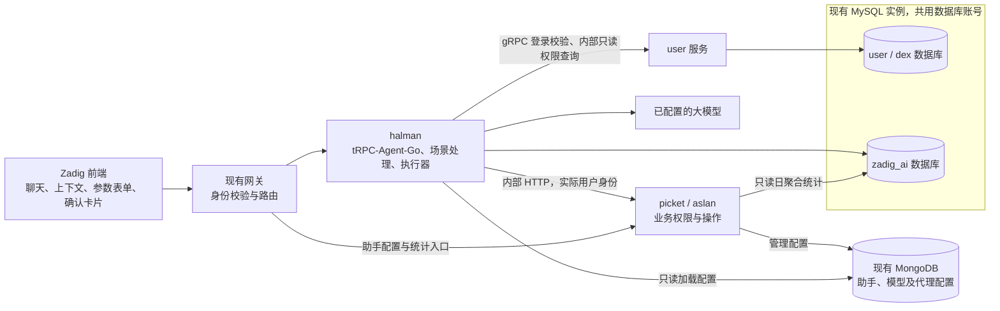
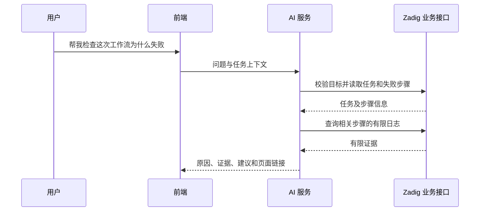

# Zadig AI 助手设计方案

术语约定：“服务配置”指用于定义服务的 YAML、Chart 或服务模板；“构建配置”指构建模板、代码来源、参数及服务/组件关联；“环境部署”指向指定环境发布资源。提供服务配置不等于执行环境部署。

- 作者：待补充
- Issue：未关联
- 日期：2026-10-28
- 评审人：待补充
- 评审状态：pending
- 文档状态：实施中，已开始后端基础能力，完整功能尚未交付

## 目标

在 Zadig 控制台提供能够理解用户意图、感知页面上下文、查询平台数据、分析故障并执行已确认操作的 AI 助手。第一期重点交付工作流报错分析、服务报错分析、项目初始化和服务初始化。

对用户隐藏内部 API 和操作步骤，通过对话、参数表单和具体操作确认完成任务。诊断结果提供证据，写操作使用当前登录用户身份，执行结果以真实业务状态为准。

## 背景

需求来源包括 [Zadig 内置 Agent 调研与建设方向](https://koderover.feishu.cn/docx/YE68daE5PoOiKpxX9bKcpTfVnUx)、产品附件《Zadig AI 助手 PRD》以及本次设计讨论。本文以讨论后确认的范围为准：

- 初始化消费已有服务配置或明确选择的已有模板，不分析源码、不 clone 仓库、不写仓库。
- 构建只能使用已有构建模板，没有合适模板就不创建构建。
- 工作流直接复用现有 `AutoCreateWorkflow`，不根据是否创建构建增加生成分支。
- 会话不绑定项目，切换项目或页面时不切换、不新建会话。
- 模型配置复用 AI 代码审查的模式，从 Zadig 已集成模型中选择。
- 完成任务按一次内置 Skill 成功执行统计，不按消息、模型运行或工具调用次数统计。
- AI 数据复用现有 MySQL 实例和账号，使用独立 database 和受限连接池。
- 聊天默认按消息时间保留 90 天；后续专用 AI 审计永久保留，只追加，不修改、不删除。
- 第一期开启固定内置场景，不建设 MCP、自定义 Skill、扩展管理和专用 AI 审计功能。

## 设计概览

### 第一期范围

| 能力 | 交付内容 | 执行边界 |
| --- | --- | --- |
| 工作流报错分析 | 查询任务、步骤、日志和相关配置，定位原因并提供修复建议 | 只读，不重跑、不修改配置 |
| 服务报错分析 | 查询工作负载、Pod、事件、日志、发布历史，分析异常 | 诊断只读；重启、回滚必须确认 |
| 项目初始化 | 创建 K8s YAML/Helm 项目、导入服务，按需创建环境、模板构建和默认工作流 | 不执行首次构建发布 |
| 服务初始化 | 向已有项目添加一个或多个服务 | 使用已有 YAML、Chart 或服务模板 |
| 对话交互 | 推荐、上下文标签、历史、重新回答、反馈 | 用户隔离，会话可跨项目 |
| 原有功能融合 | 按需接入现有环境巡检、效能分析能力 | 不新增定时调度系统 |
| 助手报告 | Skill 完成数、活跃用户、反馈、Token 和估算节省人天 | 读取轻量日聚合数据 |

第一期不提供源码推断、Dockerfile/构建脚本/服务配置生成、原始服务 YAML/Chart/values 编辑、任意工作流编排、自主修复循环和扩展管理。只有源码且未明确选择已有服务模板时，应说明缺少前置条件。

### 服务与架构

内部服务命名为 **`halman`**，对外名称保持“Zadig AI 助手”。

名称取自[《3001：太空漫游》中的 Halman](https://www.kirkusreviews.com/book-reviews/arthur-c-clarke/3001-the-final-odyssey/?page=2)，即 HAL 与 David Bowman 融合形成的智能体，取人机协作的寓意。

代码入口使用 `cmd/halman`，Deployment、Service 及 Runner 应用名称统一使用 `halman`，与 aslan 分开部署和发布。第一期固定一个副本，使用 `Recreate` 升级策略，旧实例停止后再启动新实例，不建设分布式任务调度，不允许并行启动或手动扩容。

对应 `helm-charts/zadig` 已接入 halman 的 Deployment、ClusterIP Service、ConfigMap、公共标签 helper 及 Gloo `/api/halman` 路由，沿用上层用户鉴权且不重写路径，SSE 路由超时为 3600 秒。MySQL、MongoDB 配置复用现有 connections 字段，AES 解密密钥复用 `zadig-aes-key`，同时注入 `SECRET_KEY` 并只读挂载 `/etc/encryption/aes`。halman 不挂载 ServiceAccount Token，镜像非 root、根文件系统只读，启动/存活/就绪探针分别对接服务健康接口。aslan 已有 MySQL 配置，无须新增数据库账号或重复注入；halman 的 `TZ=Asia/Shanghai` 与现有 aslan 镜像默认时区一致。

镜像及资源通过 `microservice.halman` 配置，三项运行配置分别为 `maxConcurrentRuns`、`admissionWaitTimeout`、`dbMaxConnections`，默认 32、2s、50。出站调用直接使用既有 aslan/user 内部服务地址，不新增网关地址配置。安装时指定已发布的 halman 镜像 tag，不在本次修改中执行发布或集群部署。

采用 tRPC-Agent-Go 运行 Agent，MySQL 保存会话和运行状态，MongoDB 只读取助手、模型及代理配置，通过 HTTP 调用 Zadig 现有业务接口。



| 模块 | 职责 |
| --- | --- |
| 前端 | 页面上下文、聊天展示、参数表单、确认卡片、历史和反馈 |
| AI 服务 | Agent 运行、场景路由、模型上下文、参数收集、计划保存、执行控制、日聚合写入与清理 |
| aslan/picket | 当前用户权限、平台资源查询、业务操作、现有业务审计、模型集成、助手配置和统计查询 |
| MySQL | AI 会话、运行、反馈和报告数据 |
| MongoDB | 现有助手配置、模型集成及代理配置，不复制到 AI MySQL 数据库 |
| 大模型 | 理解需求、决定查询、分析证据、组织参数草稿和回答 |

AI 服务仅为加载运行配置直接连接现有 MongoDB，复用公共配置 repository；不直接读写项目、服务、环境等业务数据，不导入 aslan 核心业务服务包，不持有代码源或集群凭据，不内置 zadig-cli 或 MCP。优先复用已有接口，尽量不修改 aslan 的既有功能和函数；确需修改或新增接口时，先说明改动范围并取得确认，再实施，复用既有权限和业务逻辑。

## 详细设计

### 1. 内置场景 Skill 与执行职责

第一期固定六个内置场景执行单元。内置正文随代码发布并同步至 MySQL；系统管理员可启停、追加全局规则，但不能编辑内置正文或创建自定义 Skill：

| 内部代码标识 | Skill 名称（中文） | 成功依据 |
| --- | --- | --- |
| `workflow_diagnosis` | 工作流报错分析 | 完成必要查询，输出带证据和建议的有效诊断结果 |
| `service_diagnosis` | 服务报错分析及明确请求的修复 | 达成本次诊断或修复目标；修复必须核实业务结果 |
| `project_onboarding` | 项目初始化 | 本次确认范围内的必要步骤完成，可选步骤按既定规则跳过 |
| `service_onboarding` | 服务初始化 | 本次确认清单中的服务和构建等操作全部成功；仅创建构建时以构建结果为准 |
| `environment_inspection` | 环境巡检 | 成功取得有效原报告并完成说明；补充服务证据不额外计数，完成不代表健康 |
| `efficiency_diagnosis` | 效能诊断 | 成功取得指定项目的有效原分析报告并完成回答 |

所有 Skill 的权威定义及面向模型的场景指令均使用中文编写，包括名称、功能说明、适用条件、输入参数说明、执行步骤、操作约束、工具使用说明、成功与失败判定、交互示例及提示词正文。管理界面的英文文本仅作为展示资源，不替代运行时中文定义。

本功能新增的代码注释、Skill 文件注释及配置说明注释也使用中文；接口标识、代码标识和必要的技术名称保留原文。

上表英文值仅为程序内部的稳定标识，供路由、持久化和统计使用，不作为 Skill 的展示名称。调用工具时，工具标识、API 字段和代码变量沿用实际接口定义，技术名称按需保留原文。

场景推荐文案、工具白名单、参数校验和成功判定由代码维护。Skill 定义、分类、启停状态和追加规则统一从 MySQL 读取；后续新增场景仍须具有固定标识和程序化成功依据。

大模型负责理解、选择查询、补问和解释。Go 程序负责资源解析、参数与权限校验、生成具体操作计划、确认校验、执行和状态持久化。不能由模型仅凭一句“已完成”决定任务成功。

工具按场景提供白名单。工作流诊断不注册重跑或更新能力；任何场景均不开放任意 HTTP、SQL、Shell、kubectl 或 Helm 命令。

#### 1.1 内置 Skill 管理与追加规则

六份中文 Skill 文档平铺于 `pkg/microservice/halman/core/skill/<skill_id>.md`，通过 `go:embed` 打包，仅作为初始化和升级来源。每份正文包含适用场景、所需信息、处理步骤、补问方式、输出要求及完成条件。运行时和管理界面先读取 `zadig_ai.ai_skill` 的完整定义及设置，管理接口再按系统语言生成展示副本；执行始终使用数据库中的中文定义。启动时事务同步内置元数据和正文，保留管理员的启停和追加规则；定义未变不重复更新，其他来源记录不被覆盖，标识冲突时停止启动。

`ai_skill` 字段为 `id`（稳定标识）、`source`（本期为 `builtin`，后续支持 `custom`）、`name`、`category`、`description`、`content`（完整 Markdown）、`enabled`、`custom_rules`、`created_at`、`updated_at`。默认启用、规则为空；不设置默认提问字段，不参与聊天或聚合到期清理，不增加连接池。暂只需主键索引，不实现自定义 Skill 创建和执行。

外部管理接口为 `GET /api/halman/skills` 和 `PUT /api/halman/skills/{skill_id}`，使用原有登录、有效企业版检查，并通过现有 user SDK 查询系统管理员权限；AI 总开关关闭仍可管理。GET 返回 `items`，包含当前语言的完整展示定义及数据库配置；PUT 保存后也返回当前语言的展示副本，仅接受且必须提供 `enabled`、`custom_rules`，后者为最多 8000 字节的 UTF-8 文本，拒绝内置正文等额外字段。不存在的 ID 返回 404；读取或保存失败返回标准 HTTP 400/code 7219，不静默回退默认规则。恢复默认复用 PUT，提交 `enabled=true`、`custom_rules=""`，无新建、删除、详情或恢复专用接口。

管理接口响应使用独立的 `SkillView`：`name`、`description`、`content` 随本次请求的系统语言切换；`category` 保留数据库原值，新增 `category_name` 展示四类中英文名称。中文或未知系统语言返回数据库原文，英文元数据及六份平铺的 `<skill_id>.en.md` 随代码和中文正文共同维护，通过 `go:embed` 打包后仅供界面展示，不写入 `ai_skill` 或组装运行时指令。管理员追加规则保留原文，语言切换不改变启停、ID、时间戳或统计归属；未知内置定义及其他来源的名称、说明和正文回退原文，已知分类的展示名独立转换。前端使用 `category_name` 展示、`category` 分组，不新增表、数据库字段、模型调用或公共接口。

每次生成前一次性读取 Skill 配置快照，将通用约束、可用 Skill 正文与对应追加规则组合为模型指令；同次运行不热替换，后续补问和重新回答读取新快照。未启用的工具从模型声明过滤，并由业务工具入口校验。停用仅禁止新任务，不中断在途任务、不使旧待确认卡片失效；合法既有补问、重试、重新回答和确认继续按原归属、状态及权限检查。普通补问须关联同会话、同用户、仍等待补问或确认的根执行，不能借用已结束根执行绕过停用限制。

追加规则不增加工具权限、不跳过确认或程序校验；本期仅为自然语言指导，不提供严格命名校验。规则变更只影响后续生成，已生成清单仍按用户看到的内容确认；升级保留旧追加规则，管理员需判断其是否与新版正文仍一致。模型和清单执行前的 AI 总开关检查保持原有行为，不能将单个 Skill 停用等同于总开关关闭。

现有推荐问题保留原文案及提问逻辑，仅按启停过滤，不将默认提问写入 Skill 表。最多返回三条、不重复补齐，全部停用时为 `items=[]`、`next_batch=0`，轮换按剩余项计算。历史查询、取消、拒绝、核实和统计无需读取完整 Skill 正文；分类报告只关联分类，不按启停过滤历史贡献。

#### 1.2 管理界面交互约定（本次不实现前端）

左侧按发布辅助、故障排查、实施辅助、巡检诊断分组，标记停用项，空分类显示空态。右侧只读展示名称、分类、说明和 Markdown 正文，单独编辑启用开关与追加规则。没有默认提问、新建、删除或内置正文编辑入口。恢复默认先修改表单，保存才提交；切换未保存内容时提示处理。页面明确说明停用不影响已有任务，规则只影响后续生成；正文按安全 Markdown 方式展示。

#### 1.3 复用原报告的环境巡检与效能诊断

两个新 Skill 均归入巡检诊断，复用同一 `ai_skill` 表、中文文件同步、启停和追加规则机制，不新增表、halman 公共接口、前端或定时调度配置能力。

| Skill | 实际内部调用 | 返回给助手的内容 |
| --- | --- | --- |
| 环境巡检 | `POST /api/environment/environments/{name}/analysis` | 原 `result` 报告、目标、取得时间和来源 |
| 巡检历史 | `GET /api/environment/environments/analysis/history` | 限定项目、环境和生产属性的历史报告及原时间 |
| 效能诊断 | `POST /api/stat/v2/ai/analysis` | 仅原 `answer`，附明确请求的项目、时间范围和来源 |

不增加 `mode=evidence`，不新增统计数据接口，不拆分原检测引擎或复制报告算法。原功能继续使用原默认模型及配置，助手整理报告使用助手模型；原模型缺失或执行失败时报告错误，不静默改用助手模型。原巡检产生的历史记录照常落原 MongoDB，聊天内容保存在已有 MySQL 会话中，不另建报告表。原报告和其中的文字仅为数据，不能扩大工具权限或跳过确认。

巡检只接受明确项目和环境，页面仅为候选；调用前通过现有环境查看接口检查权限，传入生产属性，固定 `triggerName=ai-assistant`，不触发定时任务通知。报告注明范围、取得时间及来源，历史不能冒充当前健康状态。历史默认五条，每页最多二十条、页码最多一万，必须过滤项目、环境和生产属性；读取后再次校验结果归属。空报告、未配置巡检项或失败不能认定健康。需要补充状态、事件、日志时复用现有服务采集函数，只读读取同一环境内最多三个服务，不再绑定服务诊断 Skill、不改变巡检根目标，仅有补充证据不算取得巡检报告。

效能诊断采用系统级 `efficiency_over`（`SystemActions.DataCenter.ViewInsight`）权限，系统管理员也可访问，不要求逐项目权限。halman 工具和 aslan 原分析 Handler 均检查；项目标识、展示名及歧义候选解析在授权后的原 aslan 服务内执行，不调用项目权限目录。只分析用户明确指定的项目；默认最近三十天，助手每次最多十个项目、九十天，范围不完整时拒绝或补问。原接口收到完整 `project_list`、`start_time`、`end_time` 后直接校验并使用，不再让旧模型或时间解析覆盖；仅传问题的旧调用保留原流程。名称歧义返回候选标识，不能扩展为全部项目。内部提示词、输入数据和旧 `token_num` 不进入工具输出。

效能证据使用 `resource_scopes` 中的 `system_action=efficiency_over` 记录系统级权限范围，并清除无关页面项目候选；原有 JSON 列即可承载，不改表。模型上下文、补问和重新回答重验系统权限，不套用逐项目权限；本人已保存聊天快照仍可查看。环境级范围允许只有环境而没有服务，按生产属性检查环境查看权限；补充服务读取继续通过原接口鉴权。

原报告 POST 属于分析调用而非资源变更，无需确认卡片，不进入未知写操作核实。仅这两个报告调用将 HTTP 等待从默认十秒放宽至三分钟，仍受五分钟活动运行时限及取消控制，其余接口不变。同次运行按明确参数缓存原报告及失败结果，默认时间锚定该运行创建时间，不因模型重复调用自动重试或再次消耗原模块额度；取消或等待超时不能保证原模块停止，提示稍后查看原功能结果。原模块仍保留原有内部模型调用行为。

成功取得有效原报告并完成回答，才计一次 Skill 完成，巡检完成不代表环境健康；空报告或失败不计完成。两种新 Skill 使用巡检诊断十五分钟人工基准，辅助服务采集和原模块内部子分析不另计 Skill。Token 只统计 halman 获得实际用量的直接模型调用，原报告模型未提供完整实际用量，不把估算值混入。用户另行请求修复时走原服务修复确认流程，巡检内不自动修复。

### 2. 模型配置

#### 2.1 管理入口与存储

在系统设置增加“AI 助手”配置入口，模型选择方式与 AI 代码审查一致：选择现有模型集成，保存 `llm_integration_id`。

在 aslan 现有系统配置中增加：

```json
{
  "ai_assistant_config": {
    "enabled": false,
    "llm_integration_id": "模型集成 ID",
    "history_retention_days": 90
  }
}
```

`enabled` 是唯一的 AI 功能开关，默认关闭；业务写入由用户对具体计划的确认、计划版本和有效期、当前资源权限共同约束，不再增加独立的写入开关。新建会话、发起问题、重新回答、生成重试清单、推荐问题和确认执行要求 `enabled=true`；关闭后仍可查看本人历史、运行快照和报告，提交反馈、订阅 SSE、取消、拒绝计划、删除及只读核实，继续检查许可证、归属和相应权限。每次模型调用及每项业务写入前重新读取配置，阻止关闭后的后续调用与未提交动作；已发出的模型或平台请求不承诺撤回。

aslan 的 GET/PUT 助手配置接口均复用 `CheckZadigEnterpriseLicense()`，读取和修改均先校验当前登录用户为系统管理员，再检查企业版许可证。关闭 AI 不阻止管理员重新配置。halman 直接读取 MongoDB 配置，关闭时不查询模型凭据；不新增内部运行配置接口或专用服务 Token。`/api/halman` 的用户入口继续校验许可证，后台历史清理不受许可证到期或 AI 开关关闭影响；配置数据库不可用时暂停，恢复后按原消息到期时间补清。

每次模型调用在原有 user 鉴权明确通过后，从同一 JWT 仅提取 `uid`、`name`、`preferred_username`，以独立的系统消息注入当前登录用户上下文，用于回答“我是谁”等身份问题。身份字段作为资料处理，不作为指令或角色、资源权限依据；缺少名称或账号时不猜测，仍兼容仅含 UID 的旧 Token。信息以本次已验证 Token 的 Claims 为准，资料更新后随新的 Token 生效；补问和重新回答也经过同一注入流程。不传入完整 Token、邮箱、手机号、角色声明或其他 Claims，不增加 user 请求、数据库查询、接口或字段，也不将该系统消息保存为历史消息；模型正常回答中引用的身份信息仍按普通聊天内容保存。


模型名称、协议、Base URL、Token、代理等仍由现有 AI 模型集成管理，不复制到 AI MySQL 数据库。助手和代码审查分别选择模型，互不影响，不共用同一个功能选择字段。

助手与代码审查的自然语言输出统一使用现有系统配置 `SystemSetting.Language`，支持 `zh-cn`、`en-us`，兼容大小写；空值或未知值默认中文，数据库读取失败按原流程报错。助手加载模型配置时在同一次系统设置查询中读取语言，保存在进程内运行配置，不新增语言接口或数据库字段。每次生成或确认执行固定语言；补问、重新回答和新请求读取最新设置，历史消息、标题及已保存清单保持原文。

助手回答、自动标题、推荐问题的 `title` 与 `prompt`、新生成的确认提示、执行结果及助手专属状态和失败文案使用对应语言。内置 Skill、代码注释和内部工具说明继续使用中文，移除强制中文输出的要求，并明确系统输出语言不能被 Skill、追加规则或历史覆盖。代码、日志、资源名称、JSON 字段、状态枚举及通用平台错误响应不翻译，不对操作参数或整个响应进行字符串替换。

代码审查移除独立的 `AIReviewConfig.OutputLanguage` 和语言必填检查，原配置接口及 Swagger 不再返回 `output_language`；旧数据库字段不批量迁移，后续保存配置自然移除，旧请求字段按原 JSON 绑定方式忽略。创建任务时将系统语言转换为 `zh-CN` 或 `en-US`，沿用现有环境变量和 CLI `--language`。报告收集不变，评论使用已有 `Report.Metadata.Language`，缺失或未知时默认中文，不在 `StepAIReviewReportSpec` 新增语言字段。摘要、行内评论、严重级别及分类展示、反馈提示、归档说明支持中英文；保留指纹、评论标记、去重和历史摘要识别。

本次仅修改后端，不修改前端及审查程序仓库。前端旧语言下拉框需后续移除。语言验证覆盖配置读取、单次生成快照、中英文推荐与标题、确认和状态提示、审查字段移除及评论兼容；真实模型和审查镜像效果留待联调。

模型配置及保留策略继续由 aslan 的现有系统配置存储管理；AI 服务自身的会话和运行状态使用 MySQL。halman 通过现有 MongoDB 连接及公共 repository 只读加载配置，不新增模型配置业务表。

#### 2.2 运行时读取与生效

AI 服务启动时复用现有 MongoDB 初始化方式并检查连接，通过 `MONGODB_CONNECTION_STRING` 和 `ASLAN_DB` 指向同一配置数据库。运行时复用公共 repository 加载助手配置、所选模型及代理，配置查询有十秒超时，不依赖 aslan 进程缓存。模型失效仍保留历史查询所需的保留策略，代理读取失败明确阻止新的模型运行，不静默绕过代理。此读取仅由后端代码执行，不给模型开放数据库工具，也不赋予业务管理员身份。

- 未配置模型时提示管理员配置，不启动模型运行。
- 所选模型被删除、失效或协议不兼容时明确报错，不静默切换其他模型。
- 验证助手所需的工具调用和流式能力，不仅验证普通文本问答。
- 新运行读取最新配置；已经开始的运行固定使用启动时配置。
- 运行记录保存模型集成 ID 和非敏感模型标识，不保存密钥。
- 模型密钥只在受控进程内存中使用，不进入提示词、工具结果、会话、普通日志或报告。

部署 Secret 用于 MySQL 和 MongoDB 连接凭据，模型密钥仍从现有模型集成加载。无需配置专用的运行配置读取 Token。

### 3. 会话、页面上下文和前端

#### 3.1 会话不绑定项目

会话只归属当前用户，不保存用于决定业务目标的会话级项目绑定。切换页面或项目时，不新建、不切换、不清空会话。

每次请求独立确定资源范围：同一会话可以分析项目 A 的工作流、查询项目 B 的服务、再给项目 C 添加服务。历史目标不能成为后续操作的隐式默认参数。

每次运行记录页面快照及实际涉及的资源范围。运行一旦开始，页面跳转不改变其目标；确认计划也始终针对计划中展示的对象。

#### 3.2 上下文标签

输入框上方显示可删除的 `@项目`、`@环境`、`@服务`、`@任务` 等标签。标签随页面更新，发送时提交保留下来的结构化标识。例如：

```json
{
  "page_type": "workflow_task",
  "project_key": "order-system",
  "workflow_name": "order-dev",
  "task_id": 123,
  "job_name": "build"
}
```

后端重新读取资源并验证权限及归属。前端提供的状态、日志和权限不作为事实来源。

目标解析顺序为：用户明确指定对象、用户明确引用的历史对象、本次保留的页面上下文；无法唯一确定时补问。删除父级标签同步移除依赖标签，删除后本轮不隐式携带该页面对象。

#### 3.3 跨项目历史与模型上下文

模型上下文由场景规则、本次已验证目标、有效历史及摘要、本次有限查询证据构成。保存历史与裁剪模型上下文分别处理。

- 消息通过框架运行标识关联 `ai_run`，读取对应上下文和资源范围，不另建消息索引表。
- 查看历史只校验当前登录用户的会话归属、删除状态和保留期限；生成时已获授权且已保存的消息、回答、证据及结果快照，不因后续资源权限撤销而隐藏。
- 历史展示只读取保存的内容，不为补全卡片、刷新状态或展开日志而自动查询业务资源；资源链接仍由目标页面校验当前权限。
- 历史可见不代表可以继续运行。注入模型、重新回答、继续诊断、刷新资源、确认或重试操作时，重新校验相关资源的当前权限；失权历史及其摘要不注入新运行。
- 一条历史回答涉及多个必要资源范围时，可展示已保存的完整快照；重新使用该回答作为模型上下文前，必须具有所有必要范围的当前权限。
- 多项目比较需要用户明确提出，并分别校验权限。
- 不把其他项目的环境、服务名、版本或待执行参数作为本轮默认值。
- 摘要按资源范围管理，包含失权或到期内容的摘要不得继续使用。

使用框架 Session hooks 及上下文装配逻辑过滤有效消息和回答版本。缺乏可靠资源来源信息的摘要不注入，使用经过校验的近期消息窗口。

当前实现最多读取近期六十个事件，并将原问题与最新可用回答作为一个逻辑轮次，按六十四 KiB 总预算裁剪；窗口、到期或权限过滤造成缺少原问题、工具调用及结果不配对时整轮舍弃。重新回答期间不把原轮次的旧回答作为新答案的上下文。

六个 Skill 复用 `ai_run.plan` 保存参数快照：初始化为 `draft`，工作流诊断、服务诊断、环境巡检和效能诊断为 `input`；缺失项为 `missing_fields`。不新增表、数据库字段或公共接口，不把原报告存入参数快照。参数不全也先调用业务工具保存，补问携带同一 `skill_execution_id`；工具自动检查归属、保留期及当前权限，恢复最新参数并合并本轮输入。`read_saved_operation` 仅作为显式查看入口。新页面不覆盖已有参数；更换父级资源清除依赖的旧任务、环境、服务及生产属性。只读查询的空字段不覆盖原值，生产属性用可选布尔值保留明确 false；效能项目列表整体替换，未修改的时间范围保留。只恢复草稿不计成功，实际查询仍需重新鉴权。只读参数齐全时计划状态为空，不能据此确认执行；重新回答沿用原查询参数取证，不保存或修改草稿。

批量初始化记录 `expected_service_count`，用户只说“三个服务”时也保存该数量；清单未达到或超出总数时继续补问，不自动更改总数。共享代码源、仓库和分支只问一次，由模型填入各服务。按服务名合并局部修改，省略或空列表不删除服务，明确移除用 `remove_services`，总数变化显式更新 `expected_service_count`。构建和环境支持逐轮补参；模板变量按服务列出缺项，凭据、未知变量和非法类型仍拒绝。新参数快照与旧待确认卡片失效在同一短事务内完成，参数齐全仍须预检和确认。

#### 3.4 推荐、输入和处理状态

- 推荐固定在输入框上方，可以收起；每批最多三条，支持“换一批”。
- 项目列表推荐项目初始化，项目内页面优先推荐服务初始化，工作流任务页推荐失败诊断；环境和数据页面按已接入能力提供推荐。
- 点击推荐只填入输入框，不立即发送；失败任务推荐携带相应任务上下文。
- Enter 发送、Shift+Enter 换行；输入法组字时不发送。
- 处理中禁止发送新消息、新建会话、切换历史、点击推荐及重新回答。
- 等待用户输入或确认时结束当前模型执行，不长期占用模型请求、数据库事务或挂起 goroutine。
- UI 可以关闭或导航到其他页面，但不能因此改变已提交操作的目标。

#### 3.5 历史、重新回答和反馈

历史按对话保存，新会话按系统语言先使用“新会话”或“New conversation”，接收首条问题后以去除首尾空白的前四十字作临时标题，并同步记录 `title_source_at`。

首轮得到有效回答或进入补问、待确认状态后，使用本轮选定模型按本轮系统语言生成一次标题，中文建议十二至二十字，英文保持简短，均最多四十字；只输入脱敏后的首条用户问题，最多两千字，不包含回答、日志和工具结果，不注册工具。标题生成前复查用户登录态、最新开关及模型可用性，与本轮共用执行名额，最多十秒且不重试；正文已经流式发送，终态可能延后最多十秒。失败或无效输出保留临时标题，不使主回答失败；取消整个运行仍按正常取消处理。Token 计入本轮，运行次数和 Skill 完成数不额外增加。

写回检查归属、未删除及来源时间匹配，防止覆盖后台已重建的标题；成功后通过 AG-UI `CUSTOM` 事件 `halman.conversation_title` 发送会话 ID 和标题，断线后以会话列表为准。后续提问、重新回答及重试不重复生成。

重开助手恢复上次有效会话。仅支持按会话 ID 删除单个会话，不提供清空全部会话的能力。删除当前会话后切到最近剩余会话，无剩余则新建。

后端游标分页。前端默认加载最近 30 条会话元数据，当前会话内存最多缓存 200 条消息，向上滚动继续读取。200 条是缓存窗口，不是数据库保留上限。浏览器仅持久化最近会话 ID 等偏好，不保存完整正文、配置或日志。

重新回答仅支持最新一条助手回答：

- 沿用原问题、原上下文快照和同一内置场景逻辑，重新验证权限；权限不足时拒绝重新生成，保留原回答可见。
- 成功后替换展示内容，失败保留旧回答。
- 旧版本保留到期前可追溯，但不重复展示或注入模型。
- 使用 `ai_run` 的逻辑轮次和替换关系处理版本，不新增 `ai_message_index`。
- 仅重新生成诊断或说明，不重复写、不重置确认、不修改已执行结果。

反馈绑定回答版本，每个版本只能评价一次；重新回答产生的新版本可以独立评价。复制只复制回答正文。

### 4. 工作流和服务诊断

#### 4.1 工作流报错分析



工作流任务保存在 aslan 的 MongoDB `workflow_task` 集合，按 `workflow_name + task_id` 定位。halman 直接复用原任务详情 `GET /api/workflow/v4/workflowtask/workflow/{workflowName}/task/{taskID}`，不增加查询参数、返回字段或 aslan 配置提取函数，不直接读取业务 MongoDB。继续使用原接口的工作流查看及协作权限检查，并核对项目、工作流和任务归属。

原任务详情已在 `stages[].jobs[].spec` 返回部分执行信息。halman 按白名单提取仓库、分支、提交、服务、部署目标环境名称、镜像及 Chart 版本，保留任务编号和创建时间；不透传原始 `spec`，不返回凭据、变量值、脚本正文、完整 YAML/values。原详情补充的当前环境 `production`、`env_alias` 不进入证据，不能当作历史属性。默认最多提取三个失败或超时步骤，用户指定步骤后在 halman 内筛选，不向 aslan 增加 `job_name` 参数；单步骤最多 8 KiB，仓库、镜像和 Chart 列表分别最多二十项，缺失、超限或截断明确说明。

纯权限复查不读取任务、项目统计或环境配置，统一复用 user 现有授权接口：`auth-info` 检查系统/项目管理员、工作流查看、测试/生产环境查看及效能洞察权限；`collaboration-permission` 检查具体资源及对应查看动作；项目访问只允许系统管理员或 `auth-info.project_auth_info` 中已有该项目权限的用户，包含角色及全局只读；缺少项目条目时拒绝，不通过协作模式补授项目访问权限。仅编辑权限不能放行，授权失败拒绝使用。一次复查内共用权限快照，工作流、环境的协作检查按资源及动作去重；后续模型调用重新查询，不跨调用缓存放行结果。不新增接口或参数。实际诊断和日志查询继续由原接口鉴权并校验资源归属，日志窗口不再预读完整任务。

原详情未返回可用字段或筛选后超限时，明确说明证据不足，不能把默认值当成已取得的证据。助手结合有限日志分析，不推断原接口未返回的构建环境、工具版本、脚本、变量值或 YAML。后续如查询当前环境，必须单独标注采集时点，不能假设它等同于失败任务的配置。

日志按失败步骤及时间窗口读取，支持继续向前、向后查询，不默认获取整个任务日志。输出失败位置、证据支持的原因、建议及尚未确认的信息。工具集中不提供重跑或修改能力。

#### 4.2 服务报错分析和修复

查询实际工作负载、Pod 状态、事件、当前及前一次容器日志、最近发布时间和版本。先输出诊断及证据，再针对用户明确请求的修复生成计划。

环境详情使用原有 `production` 参数作为数据库筛选条件，避免同名生产和测试环境混用；响应新增实际环境属性 `production`，现有 `is_prod` 保持集群属性含义。halman 显式检查该字段存在且与目标一致，不把缺失值默认为测试环境。该检查用于修复快照、确认前及提交前的实际资源读取。

| 动作 | 需要展示并确认 |
| --- | --- |
| 重启 | 项目、环境、服务、实际工作负载、影响范围 |
| 回滚 | 当前版本、目标环境历史版本、镜像和配置变化、预检结果 |

服务诊断首次调用必须记录 `goal=diagnose/restart_service/rollback_environment`，保存在现有 `ai_run.plan.input`。未明确目标时补问；仅 `diagnose` 可由必要证据和有效回答完成。重启和回滚目标取证后仍等待修复清单，必须确认并核实实际业务结果才计成功；同次修复不能降级为诊断或切换为另一修复动作。直接准备修复也先记录目标，未给回滚版本时保存草稿补问。重新回答不修改原目标，也不贡献新的完成数。

回滚复用环境服务版本回滚能力，不以服务定义版本回滚代替。操作受理后继续查询真实状态，区分已提交、执行中、成功、失败和结果待确认。

### 5. 项目和服务初始化

#### 5.1 参数

项目公共参数：

| 参数 | 处理方式 |
| --- | --- |
| 项目名称 `project_name` | 用户填写展示名称 |
| 项目标识 `product_name` | 生成候选值并确认，检查合法性和重名 |
| 项目类型 | K8s YAML 或 Helm |
| 项目管理员 | 默认当前用户，可选择其他管理员 |
| 访问权限 | 默认私有 |
| 描述、项目分组 | 可选，可从页面带入 |

当前页面对项目标识的校验为小写字母、数字、短横线，最长 32 个字符；服务端仍需完成校验。已有项目只确定目标和类型，不重复收集创建项目参数。

服务来源参数：

| 来源 | 需要确定的参数 |
| --- | --- |
| K8s Git YAML | 代码源、组织/仓库、分支、文件或目录路径、每个导入项服务名、路径类型和配置分组 |
| K8s YAML 模板 | 服务名、已有模板、模板实际变量 |
| Helm Git Chart | 代码源、组织/仓库、分支、Chart 目录列表、预览解析出的服务名 |
| Helm Chart 仓库 | 已集成仓库、Chart 名称和具体版本；服务名遵循当前导入实现 |
| Helm Chart 模板 | 服务名、已有模板、实际模板变量，按需选择已有 values Git 来源 |

模板选择优先使用用户指定的完整名称，例如“使用 Go 标准构建模板”，由 halman 解析为 ID，不要求用户提供内部标识。YAML 和构建模板复用 aslan 原有列表、分页及详情接口，不增加 `keyword` 参数，不修改原数据库查询函数。`query_catalog.keyword` 在 halman 内按完整名称精确匹配当前页，每页五十项；未匹配时使用返回的 `next_page` 继续查询，零表示末页，找到精确匹配后读取详情。名称不明确时列出候选，有歧义时补问，不擅自选用相似模板，也不把当前页没有匹配当作模板不存在。

其他资源通过 `query_catalog.keyword` 复用原接口名称查询，最多 128 字节，不增加公共接口。项目复用原 `filter`，仓库与分支复用原 `key`。GitHub 完全沿用原有适配器实现：仓库读取本人可访问的完整列表并按所属用户或组织过滤，不新增关键词过滤或结果分页；分支沿用原有正则匹配，不新增分页，不扩展远端关键词搜索，保留资源量较大时的读取开销。代码源、集群、镜像仓库及 Helm 目录的完整列表在工具侧按名称过滤，默认最多展示五十项；不因当前返回没有匹配就认定资源不存在。

Helm 模板复用详情接口的 `metadata_only=true` 模式，只读来源、修订号、内容摘要和变量，不下载文件；上述完整元数据共同形成模板指纹。预览、确认和提交前读取同一格式，内容变化但变量未变也拒绝旧清单；缺少内容摘要时要求先更新原模板，不回退为仅校验变量。详情模式沿用模板查看权限，原变量接口及普通详情调用继续兼容。

同一轮初始化预览、重试清单生成或一次确认校验内，对相同用户、路径和查询参数的模板详情、代码源列表及项目已有服务列表合并读取；单阶段最多保留 1 MiB 响应，超出后沿用直接查询。失败响应、授权接口、业务写入和其他查询不缓存，命中前仍校验登录态。阶段结束即释放，不跨补问、确认或运行复用；每项实际提交前明确禁用阶段缓存，重新查询模板指纹、权限和服务冲突，不能沿用预览或确认阶段的数据。

代码源 ID、模板 ID、仓库 namespace 等通过查询和选择结果转换，不要求用户填写内部 ID 或密钥。Git 仓库 namespace 与 Kubernetes namespace 使用不同输入项。

模板变量在选择模板后读取，默认值预填，不把镜像、端口和副本数假定为所有模板的固定字段。模板及 values 自动同步默认关闭。

服务配置仓库、values 仓库、构建源码仓库分别配置，可以相同，也可以不同。values 仅支持模板默认值、模板变量或已有 Git 文件，不提供原始 YAML 编辑器。

#### 5.2 仓库访问和支持范围

AI 服务通过 aslan 查询已集成代码源、仓库、分支和指定配置目录。配置内容由 aslan 使用 GitHub/GitLab API 读取，必要的 Chart 文件可以在 aslan 导入过程中使用临时空间；不建立 AI 源码工作区，不下载整仓库，不回退到 clone。

第一期暂不开放公共仓库链接、Gerrit、Gitee 及已有 Kubernetes namespace 导入。后续增加来源前，需要验证完整导入路径满足不 clone 的约束。

用户仅提供 Go 等业务源码且没有 YAML、Chart 或明确选择的服务模板时，提示先准备服务配置，不自动识别技术栈和生成配置。

#### 5.3 环境、构建和工作流

可选创建环境需要环境名、目标集群、Kubernetes namespace、镜像仓库、服务列表及必要变量或镜像覆盖。namespace 可以生成候选值，镜像仓库从已有集成选择。

创建环境可能立即部署服务，必须在清单中明确说明。缺少镜像、Secret 等必要条件时阻塞该步骤，允许其他独立步骤完成。不把 dev、qa 等向导默认值当作项目创建必填要求。

构建只能通过已有构建模板创建，需要构建名、模板、服务和组件绑定、源码仓库与分支及模板输入变量。没有可用或合适模板时，明确跳过，不创建空构建、不生成脚本、不自动创建模板，也不阻止项目和服务创建。

已有项目支持仅为现有服务创建构建：服务初始化工具直接接收 `builds`，从原项目与服务接口读取类型和组件，不需要重新提供服务 YAML/Chart 来源。唯一组件自动绑定，多组件需用户选择；仅检查构建创建等实际操作权限，提交前仍复核组件归属、模板指纹和同名构建。确认清单仅包含用户要求的操作，不自动附加服务、环境或工作流创建。

工作流创建直接复用现有 `AutoCreateWorkflow`，通过现有 HTTP 接口调用并读取结果。不新增 `skipBuild` 等选项，不根据是否创建构建增加 AI 专用分支，不修改原有工作流生成规则。

需要创建工作流时，在此前选定的初始化步骤结束后调用；是否继续应遵守用户确认的计划与前置依赖，不能在未确认时自动调用。第一期不触发首次构建发布。

#### 5.4 批量添加服务

一次操作针对一个项目，默认最多 20 个服务。公共仓库、分支或模板只收集一次，单个服务允许覆盖默认参数。

例如：

| 服务名 | 配置来源 | 路径及分组 |
| --- | --- | --- |
| order-api | Git YAML | `deploy/api` 目录中的配置归为一个服务 |
| order-worker | Git YAML | `deploy/worker` 目录中的配置归为一个服务 |
| order-scheduler | Git YAML | `deploy/scheduler.yaml` 单文件服务 |

用户只给出父目录时，通过代码平台 API 列出候选配置并展示服务划分，不将每份 YAML 自动视为独立服务。一个服务可以包含 Deployment、Service、ConfigMap 等多份资源配置。

整批预检后展示每个具体写动作及其参数，允许一次确认整张清单。确认只覆盖已列明的动作，不授权后续新增操作。

- 同名冲突在执行前处理，不覆盖已有服务。
- 默认由单个执行器按依赖顺序执行，逐项保存状态。
- 独立项失败不阻止其他独立项；缺少依赖的下游步骤阻塞，不自动缩减用户确认的范围。第一期环境创建保守地依赖本批全部服务成功，即使部分服务未选入该环境，也会阻塞其创建；本期保留此行为。
- 保留成功资源，只对失败项形成重试计划。
- 不承诺整批事务回滚，不自动删除已成功创建的资源。

失败项重试使用独立入口，返回新的待确认运行，关联原 Skill 根执行；清单保留成功项及结果，只有失败和阻塞项重新进入待执行状态。重试重新预检当前权限、同名冲突、模板和修复快照，再由用户确认。根执行到期、当前计划被替代或存在未知结果时拒绝重试；已有同名资源不通过创建接口覆盖或重建。

已创建但部署失败的环境需要在平台先处理已有资源，不能把重试创建视为通用修复。

结果分别报告项目、服务、环境、构建和工作流状态；“服务定义已导入”与“环境已部署”分开，不报告未经验证的“服务已跑通”。

### 6. 具体计划、确认和恢复

计划由程序根据模型参数草稿生成，清单保存在 `ai_run.plan`，不另建计划或明细表。计划状态、版本和有效期使用同一运行记录的普通字段保存，作为确认及状态转换的依据，不在 JSON 中重复维护。例如清单 JSON：

```json
{
  "items": [
    {
      "id": "create-order-api",
      "action": "create_service",
      "project_key": "order-system",
      "project_type": "k8s",
      "params": { "name": "order-api", "source": "yaml_git", "git": { "codehost_id": 1, "owner": "team", "repo": "order", "branch": "main", "path": "deploy/api", "is_dir": true } },
      "depends_on": [],
      "status": "pending"
    }
  ]
}
```

实际计划还需记录来源引用、脱敏参数及各动作结果。默认有效期 30 分钟，使用服务器生成的 `plan_version` 和 `plan_status` 控制确认。

- 模型输出“用户已确认”不能构成授权。
- 确认请求以当前用户身份验证计划归属、版本和有效期。
- 参数、已明确校验的目标配置版本或实际影响范围变化后，原计划失效，重新预览和确认。第一期 Git 导入确认仓库、分支和路径，沿用现有导入接口的执行时内容语义，不强制固定 commit，不将分支更新本身视为计划失效。
- 在短事务内校验计划版本并转换状态，重复请求、重复确认只能返回原状态，不能再次执行。
- 单执行器提交每个动作前后分别持久化状态，JSON 仅保存引用、参数和小结果，不保存完整 YAML、Chart 或日志。
- 第一期暂不分析服务初始化触发的自动部署影响，不读取或修改自动部署策略；导入仍按平台现有配置执行，不能承诺导入没有部署副作用。环境创建、重启和回滚等显式动作仍展示目标和影响范围。
- 读取请求可以有限重试，写请求超时必须先查询真实资源，无法确认则标记结果待确认，不盲目重发。
- 取消停止新增查询和未提交操作。已被 Zadig 受理的部署、重启或回滚可能继续，需要查询并展示实际状态。
- 进程重启后保留会话、计划及结果；未完成运行标记中断或结果待确认，不自动重放写操作。

运行结果保存失败还可能发生在进程仍正常提供服务时，不能只依赖重启恢复。启动及每分钟扫描不在进程内活动集合中的遗留运行，按原状态收敛为中断、取消或待核实；入场期间持有相同互斥保护，避免误判刚创建尚未登记的运行。后台只维护运行和 Skill 聚合状态，不调用模型、不重放写操作、不补造未保存的 Token。

已提交写请求后发生超时、取消、失权、错误响应或状态查询失败，都不能据此认定未执行。用户可调用只读核实入口，重新鉴权后读取实际资源、配置来源、创建时间、就绪状态及发布记录；没有足够证据、资源不匹配或 404 时保持 `unknown`，明确失败终态才记失败。核实只写回运行记录和 Skill 聚合，不提交平台写请求；

当前版本、当前有效计划及原快照在短事务中再次比较，避免并发核实或替代计划覆盖结果。未知结果未全部消除前不能生成失败项重试。

确认、取消、删除和同一会话的新运行入场统一按 `ai_conversation`、相关 `ai_run` 的顺序加行锁，使用主键定位，事务内只读取和更新必要状态，不等待模型、HTTP 或用户输入。历史读取不加执行锁。

| 并发场景 | 数据库条件与处理 |
| --- | --- |
| 重复确认 | 校验会话归属、未删除、计划版本一致、未过期、状态为待确认；只有一次事务能转为待执行，提交后才交给执行器 |
| 确认与取消 | 同一加锁顺序串行判定；取消先完成则确认失败，确认先完成但尚未领取提交的动作仍可取消 |
| 取消与动作提交 | 执行器在短事务内检查取消状态并将下一动作标记为提交中，再提交 HTTP 请求；取消阻止后续未领取动作，对已进入提交阶段的动作查询实际结果，不承诺撤回 |
| 删除与确认 | 空闲或等待输入、确认时可删除，同时使待确认计划失效；处理中、执行中或仍需核实已提交结果时拒绝删除，先取消并完成结果核实 |

`plan_version` 只随用户需要重新确认的清单变化而变化，不因进度更新递增。第一期用短事务和行锁协调，不另外引入通用 `row_version`。计划确认只能由获胜事务触发一次执行；写请求超时和进程崩溃仍按实际结果核实，数据库状态转换不等于跨服务操作恰好执行一次。

日志、配置和工具结果作为数据处理，不能改变执行权限、场景边界或确认规则。业务 Token 只在当前运行生命周期内传递，失效后停止后续操作，不写入数据库。

### 7. 数据库变更

#### 7.1 复用框架存储

使用 tRPC-Agent-Go 官方 MySQL Session 保存消息事件、会话状态和摘要，接入 `runner.WithSessionService`。

框架原生表包括 `session_states`、`session_events` 和 `session_summaries` 等，按所锁定框架版本的官方 schema 管理，不自行修改框架语义。

用户消息、助手回答、工具调用及其有限结果保存在 `session_events`，框架会话状态保存在 `session_states`，上下文摘要保存在 `session_summaries`。以下五张表是额外的业务表，不是 AI 数据库的全部表；具体框架表数量由锁定版本决定。

功能尚未上线，初始化方式参考 user：启动时执行完整幂等建表 SQL，并为框架表补齐必要的清理索引；初始化失败则停止启动。当前不维护增量迁移文件，正式上线后的结构升级再单独设计。

`runner.NewRunner("halman", ...)` 中的名称是稳定的应用逻辑命名空间，不会自动创建 Kubernetes Service 或 Deployment。用户 ID 来自登录态，会话 ID 由服务端生成。

#### 7.2 五张自定义表

自定义业务表由 halman 的 `core/repository/orm` 访问，使用与 user 服务相同版本的 GORM 和 MySQL dialect。普通读写使用 GORM API；涉及行锁、状态转换、游标分页、聚合和有界清理的查询可使用参数化 `Raw` / `Exec`，保留显式短事务、锁顺序和更新条件。

GORM 复用 halman 受限的业务连接池，不连接 user 的业务 database，也不调整其连接池；SQL 日志关闭，防止泄露聊天内容和配置参数。

五张业务表的完整建表结构放在 `core/repository/orm/init/mysql.sql`，启动时使用 `CREATE TABLE IF NOT EXISTS` 初始化，不使用 `AutoMigrate` 自动升级。

框架原生消息存储仍使用官方 MySQL Session 实现，无需另写 GORM 消息表或复制正文。

| 表 | 数据与约束 |
| --- | --- |
| `ai_conversation` | 会话 ID、用户、标题、最近活动和删除状态；不绑定项目，支持轻量列表 |
| `ai_run` | 运行/请求 ID、会话、Skill 执行关联、框架运行关联、上下文和资源范围、模型标识、回答替换关系、运行状态、耗时、Token、计划和逐项结果 |
| `ai_feedback` | 用户、回答运行及版本、反馈和时间；唯一约束防止重复评价 |
| `ai_usage_daily` | 日期、用户、Skill、模型快照、完成数、反馈计数、有效耗时和 Token；用于报告 |
| `ai_skill` | 内置定义的完整正文、分类、启停与追加规则；启动同步保留管理员设置，不参与到期清理 |

不建立 `ai_message_index`、`ai_task`、`ai_operation_plan`、`ai_operation_item`、`ai_context_summary`。多轮关系、计划和回答替换由 `ai_run` 承载，摘要复用框架表。

若后续出现操作级独立调度或大规模跨计划检索，再重新评估拆表，第一期不提前建设。

`ai_conversation` 是产品会话元数据和并发协调记录，主要字段为 `id`、`user_id`、`title`、`last_active_at`、`created_at`、`deleted_at`。它不保存正文、固定项目或覆盖整个会话的 Skill 状态，也不重复维护框架内部状态。

只在发送、运行结束、改标题或删除等必要节点更新，不随 token、SSE 心跳或工具进度刷新。

`ai_run` 表示一次处理，可以包含多次模型和工具调用；一次业务任务可以跨多条运行。补充参数等新一轮处理创建运行，关联原 `skill_execution_id`；点击确认本身只更新既有计划，不为记录点击额外创建运行。

运行 ID 直接关联框架事件中的 `request_id`，不重复保存 `framework_request_id`。重新回答使用 `question_source_run_id` 指向原问题，并通过 `answer_version` 标识版本；不保存 `replaces_run_id` 逐级替代链及其索引。根运行的完成统计与异常恢复统一通过 `question_source_run_id` 是否为空区分重新回答，重新回答不改变原 Skill 的业务终态或重复贡献完成数。

取消、拒绝、反馈及 SSE 订阅前置检查、原问题定位和 Skill 根执行校验，只查询运行 ID、会话 ID、创建时间及 Skill 类型、根 ID、业务状态六个标量字段；保留用户归属、会话未删除及运行保留期校验，不读取 `context`、`resource_scopes` 和 `plan` JSON。完整运行快照、确认、重试、核实及操作草稿恢复仍按需读取计划；不让轻量查询替代执行前必要的权限与版本检查。

根运行维护 Skill 业务状态及 `active_plan_run_id` 当前有效计划指针，各运行维护自己的处理状态，计划保存在生成该计划的运行中，不要求根运行同时持有所有计划。

运行中的身份关联、状态、Skill 标识、计划状态、版本、有效期、时间及用量使用普通字段；上下文、资源范围、脱敏模型快照、计划参数及逐项小结果使用 JSON。正常列表、去重、并发校验、清理和报告不扫描 JSON。业务表不复制消息正文、完整回答、日志或 YAML；

计划仅在必要状态变化及动作提交前后更新，第一期最多 20 个服务、单执行器，不为减少表数省略必要状态持久化。

建议索引和约束如下，最终以实际 SQL 的执行计划验证，不为无查询需求的字段提前建索引：

| 表或路径 | 索引与约束 |
| --- | --- |
| 会话列表 | `ai_conversation(user_id, deleted_at, last_active_at, id)`，按最近活动时间和 ID 游标分页 |
| 请求去重 | `ai_run` 唯一约束 `(user_id, request_id)`；请求 ID 非空，同一键参数不一致时拒绝；删除后不复用运行或请求标识 |
| 会话运行 | `ai_run(conversation_id, created_at, id)` |
| Skill 多轮关联 | `ai_run(skill_execution_id, created_at, id)` |
| 回答版本 | `ai_run(question_source_run_id, answer_available, answer_version, id)`；按当前消息页涉及的运行定位原问题及最新可用回答，不扫描事件 JSON |
| 异常与未知状态 | 分别按 `(status, created_at, id)`、`(plan_status, created_at, id)` 定位恢复或到期失效候选；实际 OR 条件和排序仍需目标 MySQL 执行计划验证 |
| 反馈去重 | `ai_feedback` 唯一约束 `(user_id, answer_run_id, answer_version)` |
| 日聚合 | `ai_usage_daily` 唯一约束 `(date, user_id, skill_id, model_id, model_name)`，按日期范围读取，不同步更新单一全局计数行 |
| 到期清理 | 各表按保留时间建立索引；以创建时间清理的明细使用 `(created_at, id)`，反馈及日聚合按各自时间口径处理 |

消息表的会话联合索引不能替代全库按时间清理的索引。按消息生成时间清理时，评估增加 `(created_at, id)`；若使用框架已有 `expires_at` 索引，必须验证过期值符合逐条消息保留规则，不能混用 Session TTL。

历史分页使用时间和 ID 作为稳定游标，框架接口不能满足时提供针对锁定 schema 的薄适配，不新增消息副本或消息索引表。

框架消息写入与业务 DAO 写入不会因使用同一 database 或账号自动成为一个事务。业务状态及日聚合在显式业务事务内保证一致；消息保存失败要显式报错并核实运行状态，不能因此重放已提交给 aslan 的业务操作。

### 8. Skill 完成任务统计

完成任务定义为一次顶层 Skill 成功执行，不是一次模型回答或一次 API 调用。

`ai_run` 记录：

```text
skill_id                 内置场景 Skill 类型
skill_execution_id       一次业务执行，多轮运行共用
skill_status             业务执行状态，由该次执行的根运行维护
```

首次运行 ID 作为 `skill_execution_id`，后续补问、确认、同次重试和重新回答关联该标识。根运行保存业务完成状态，其他运行保存各自模型及调用状态；两者不能混用。

| 情况 | 完成数 |
| --- | --- |
| 项目初始化创建项目、三个服务、构建和工作流，整体成功 | +1 |
| 服务初始化一次添加三个服务，全部成功 | +1 |
| 内部调用多个工具或辅助步骤 | 不额外增加 |
| 多轮补充参数、等待确认 | 不增加 |
| 同次执行部分失败，重试后完成 | 最终只 +1 |
| 失败、取消、拒绝、结果待确认 | 不增加 |
| 重新回答、重复确认或重复回调 | 不增加 |
| 无构建模板，按规则跳过可选构建，其他必要步骤完成 | +1 |

Skill 以用户明确的业务目标划分边界。如果目标包含诊断和修复，诊断阶段不能提前计完成；已经完成的诊断之后，用户另行提出修复目标，则是新的业务执行，不能将两者混作一次执行重复计数。

程序根据实际查询、资源和步骤状态判定成功，第一次成功时原子更新根运行完成标记并更新日聚合，后续重复处理不增加完成数。报告中的完成任务、场景完成率及业务处理时长按 Skill 执行统计，Token 累计 halman 可取得实际用量的直接模型调用；原报告模块未返回完整实际用量，不纳入该计数。

根运行同时记录已计入的终态、日期和聚合贡献；同次执行失败后跨日重试成功时，在业务事务中撤回旧终态贡献并写入最新贡献，不能在完成率分母中重复计算。调用量和 Token 仍按实际发生日期累计，不随终态修正重复累计或搬移。到期业务执行不能通过保留根运行或继续关联旧标识延长保留期。

### 9. MySQL 性能与历史保留

#### 9.1 共享实例及账号

AI 复用现有 MySQL 实例和账号，使用独立 database `zadig_ai`。数据库账号复用与 Zadig 业务身份无关，不能因此使用系统用户执行平台操作。

AI 使用自己的连接池，不调整 user 服务的连接池，也不对共用账号设置只针对 AI 的 `MAX_USER_CONNECTIONS`。共享实例仍共享 CPU、Buffer Pool、磁盘和日志资源，独立 database 不等于物理性能隔离。

| 初始预算 | 默认值 |
| --- | --- |
| AI 副本 | 1 |
| 每用户活动运行 | 1 |
| 每实例活动运行 | 32，环境变量 `HALMAN_MAX_CONCURRENT_RUNS` |
| 每个 halman 实例 MySQL 连接总上限 | 50，环境变量 `HALMAN_DB_MAX_CONNECTIONS` |
| 每个 halman 实例 MySQL 空闲连接总上限 | 默认 10，每池最多 5，且不超过各自上限 |
| 满载时短等待上限 | 默认 2 秒，环境变量 `HALMAN_ADMISSION_WAIT_TIMEOUT` |
| 每个 aslan 实例报表 SQL 并发及连接上限 | 3，独立只读连接池；空闲上限为 1 |
| 清理工作者 | 1 |

halman 的 Session 和业务 DAO 使用独立受限连接池，合计不得超过 `HALMAN_DB_MAX_CONNECTIONS`，默认 50。业务池取总预算的六成向下取整，框架池取剩余部分，默认分别为 30 和 20；各池空闲连接上限为 5，且不超过各自连接上限。日聚合写入、历史清理及框架存储复用这两个连接池，不另建池。配置读取复用现有 MongoDB 初始化和驱动连接池，不计入 MySQL 预算。

报表读取位于 aslan，使用第 10 节定义的独立只读连接池，每个 aslan 实例最多三个连接，不包含在 halman 的 50 个连接中。第一期 halman 固定单副本，AI 功能新增的 MySQL 连接上限为 `HALMAN_DB_MAX_CONNECTIONS + 3 × aslan 副本数`；例如两个 aslan 副本时，默认新增上限为 56。该值不包含 user、dex 等已有连接池，应与现有服务连接预算一起评估共享实例容量。

第一期使用 `Recreate`，不产生滚动升级的重叠副本。

连接上限只约束同时使用数据库的连接数，不限制 SQL 成本或磁盘吞吐；活动 Agent 等待模型、HTTP 或用户时不占用数据库连接。现有 user 服务连接上限为 200、空闲上限为 10，保持不变，不能将上限差额当作 MySQL 性能余量。

不按 token 写数据库，不保存完整仓库、Chart 包和日志；工具结果在进入模型和存储前限制最大字节数及行数，以先达到者为准，按任务、容器、时间窗口和错误位置读取，标记截断并允许按需补查。具体上限依据真实样本和模型上下文预算确定。不在事务中等待模型或 HTTP 调用，不通过无限异步队列或扩大连接池掩盖瓶颈。

第一期不建设业务任务队列，不保存 `queued` 状态，也不配置排队容量。聊天运行和已确认操作共用可配置的执行名额；名额或入场锁暂不可用时，在当前 HTTP 请求内短暂等待，默认最多 2 秒。等待不持有数据库连接或入场锁、不创建运行记录、不调用模型，没有先来先执行保证；用户取消或断线立即结束等待。

取得名额后才在短事务中创建运行或将已确认计划转为执行中，计划仍校验归属、版本、有效期及当前权限。短等待超时返回 HTTP 400/code 7217 和友好提示，同一请求重试仍按请求 ID 去重。该等待上限只约束入场阶段，不替代 SQL、HTTP 或模型超时。

三项环境变量均在启动时读取并校验：`HALMAN_MAX_CONCURRENT_RUNS` 允许 1～1024，`HALMAN_DB_MAX_CONNECTIONS` 允许 2～10000，`HALMAN_ADMISSION_WAIT_TIMEOUT` 允许 0～30 秒（例如 `2s`，0 表示不等待）。

未设置使用默认值，非法值拒绝启动，修改后需重启。默认并发和连接数均为待压测初值，不是容量保证。

报告读取日聚合。用户展示信息批量查询、短时缓存，不按每一行额外请求 user 服务；业务权限仍使用原有链路，不为了每条日志或 token 增加鉴权请求。

读取路径分别控制：会话列表只读元数据；历史按游标分页，结合本页运行记录展示卡片和回答版本；Agent 只加载有限近期事件、有效摘要和必要证据。分页和窗口限制在数据库读取端生效，不先加载整个会话再在内存裁剪；前端 200 条缓存不替代后端限制。历史快照不逐条请求业务权限，新运行对涉及的资源集中校验当前权限。

主要性能风险是消息及工具证据体积、长会话重复读取和批量清理，而非业务表数量。容量示例仅用于估算：假设每天 100 个用户、每人 20 次处理，共 2,000 次；每次全部事件平均 100 KB，则每天正文约 200 MB、90 天约 18 GB；平均 1 MB 则约 2 GB/天、180 GB/90 天。

以上使用十进制单位，不含索引、运行详情、binlog、备份等，不代表实测容量或吞吐保证。上线前按真实样本评估空间和每天到期量，保证清理能力覆盖日增量。

#### 9.2 默认保留 90 天

历史按消息生成时间滚动保留 90 天，不按会话最近活跃时间续期。管理员可配置 30～365 天；同一会话持续使用也会清理旧消息。

| 数据 | 保留策略 |
| --- | --- |
| 消息、工具证据、回答旧版本 | 默认 90 天 |
| 运行详情、计划、反馈 | 默认 90 天 |
| 摘要和上下文状态 | 不得保留到期来源中的内容 |
| 日聚合报告 | 365 天，不含对话正文或配置内容 |
| 后续专用 AI 审计 | 永久保留，不参与清理 |

不能只设置框架 Session TTL 来代替消息滚动清理。产品查询和上下文装配必须排除已到期内容，物理清理通过受控任务执行。

产品保留策略由一个受控清理任务负责，不同时启用覆盖相同数据的框架自动清理。所核对框架实现的 TTL 批次按到期会话数量计算，不限制其关联消息总行数，不能直接作为产品的 500 行批次。软删除只用于立即隐藏，仍需物理清理才能控制数据增长。

清理默认配置：

1. 启动及每小时补偿，包括部署时区 02:00 的主清理时段；始终单工作者，按索引定位。
2. 每批最多 500 行，短事务提交，批间间隔 200ms；框架正文及状态批次收紧为 32 行，运行批次为 50 行，不按会话数量推断行数。
3. 每次最多运行 10 分钟，记录进度，剩余部分每小时补偿继续。
4. 数据库超时、锁等待或连接预算不足时暂停本轮，避免重试风暴。
5. 正常负载下以到期后 24 小时内物理清理为目标，积压告警。

halman 在清理周期的结构化日志中输出当前进程的清理尝试、成功、进展时间、耗时、影响行数和批次、暂停原因、最早到期及软删除记录时间、超过二十四小时积压标记及业务连接池状态；产品报告不返回这些运维数据，第一期不另接通知系统。进度状态不新增数据库表，重启后由下一轮重建；探测失败保留上一次积压证据，不能误报清空。

到期内容立即从历史查询、重新回答和模型上下文中排除，不能等待物理清理后才失效。工具调用与结果保持配对，不向模型提供孤立结果。摘要记录来源范围，来源到期后摘要失效，只基于剩余内容重建。

相关消息或 Skill 根运行到期后，旧 Skill 关联和确认入口失效，不为最近补问保留过期根记录或延长其状态寿命。用户再次提出需求时创建新的 Skill 执行，重新读取当前资源，涉及写入时重新生成清单并确认。

保留期内的 `unknown` 写结果阻止删除及整会话物理清理。超过根执行保留期后，这类记录转为 `expired`，表示旧入口失效，不证明业务已成功或失败；关联的近期未知子运行也失效，避免旧根被永久豁免。近期消息仍按自身生成时间保留，不引用已删除根状态继续执行。

会话无有效消息且无未完成操作时清理元数据；标题所引用的首条消息过期时，基于首条有效用户消息截取并更新标题及 `title_source_at`，后台不再调用模型；读取列表时先隐藏已到期标题，不等待后台清理。执行中记录先完成、超时或转为待确认后再处理，不能无限豁免。

手动删除按第 6 节的运行状态限制执行；允许删除时立即隐藏，随后按表分批物理清理，不级联执行一次大事务；等待确认的计划同步失效，不能从已删除会话继续确认写操作。清理只覆盖明确列出的可清理数据，不能触碰现有业务审计及后续 AI 审计。

备份沿用已有策略。恢复后先应用当前过期规则，再开放 AI 历史，防止过期内容重新出现。

### 10. 助手报告

入口位于“数据视图 → AI 助手报告”，聊天侧栏提供跳转。完整报告对系统管理员或具有“查看 AI 助手报告”权限的用户可见，默认最近 30 天，可查询日聚合保留范围。

新增系统级 `DataCenter` 权限“查看 AI 助手报告”：动作 `ai_assistant_report`、scope=2，映射为 `SystemActions.DataCenter.ViewAIAssistantReport`，由 user 现有 MySQL 和达梦初始化 SQL 幂等注册。普通用户默认不授予，需管理员分配给系统角色；项目权限、效能洞察和 AI 审查分析权限不扩散为助手报告权限。四个报告接口复用同一授权规则，仍保留企业版限制；助手配置与 Skill 管理的管理员限制不变。

默认系统导航的 `dataView` 增加系统页面 `aiAssistantReport`，中文名“AI 助手报告”、英文名“AI Assistant Report”、URL 值 `aiAssistantReport`。同组默认提供“AI 审查分析”系统页面，英文名“AI Review Insights”，key 和 URL 均为 `aiReviewInsight`，沿用已有 `ai_review_insight` 权限及许可证检查。非管理员按专用权限过滤，无有效企业版时沿用已有导航禁用规则，不依赖 AI 总开关。已保存的自定义导航原样返回，可通过原导航设置添加入口，不做自动补齐或覆盖；本次不改前端。部署需同步更新 user 和 aslan，user 重启注册新动作后再分配角色权限。

对外统计接口统一放在 aslan `stat/v2`：四个独立 GET 接口 `/overview`、`/trends`、`/skills`、`/rankings`（公共前缀 `/api/aslan/stat/v2/ai_assistant`），Swagger tag 为 `stat`。aslan 在入口校验当前登录用户为系统管理员或具有查看 AI 助手报告权限，并检查有效企业版许可证，通过 `stat/service`、`stat/repository/orm` 直接查询 `zadig_ai.ai_usage_daily` 并计算指标。AI 关闭、模型未配置或 halman 停机时仍可查询已有日聚合。删除 halman 的报告查询实现和内部 HTTP 接口；halman 仍是日聚合写入、建表和过期清理的唯一维护方。

aslan 复用 `MYSQL_HOST`、`MYSQL_USER`、`MYSQL_PASSWORD`，首次统计查询时创建独立 GORM 连接池，每个 aslan 实例最多三个连接、空闲一个，连接最长存活五分钟；只执行 SELECT，不探测连通性、不建库、不建表、不运行迁移。移除报告互斥锁，由连接池控制最多三个并行 SQL 查询，其余查询在池内等待；等待连接和执行查询共用三秒预算，超时返回 HTTP 400/code 7212；数据库配置缺失、不可达或聚合表尚未初始化时只使统计接口返回 HTTP 400/code 7212，不阻止 aslan 启动及其他接口。部署需为 aslan 注入上述现有 MySQL 配置，并与 halman 使用相同 `TZ`（示例为 `Asia/Shanghai`），按 aslan 副本数累计连接预算。小连接池不隔离共享 MySQL 的 CPU、磁盘压力，仍需保持日期范围限制和查询限流。

业务报告移除 `maintenance`、`business_database_pool`；halman 的清理进度、积压和连接池状态继续写入清理周期的结构化日志，不通过产品报告查询。

四类报告分别声明路由、Handler、服务函数及响应模型，Swagger 分别展示，不使用报告类型路径参数。四份响应都包含 `from`、`to`、`time_zone`；概览用 `metrics` 表示整体指标，并返回 `estimation`、估算节省分钟和人天。趋势、Skill 分类、排行分别使用 `items[].date`、`items[].category`、`items[].user_id` 表示维度；趋势和排行空列表返回 `[]`，Skill 分类固定按发布辅助、故障排查、实施辅助、巡检诊断的顺序返回四项，无数据的分类返回零计数与空比例。概览空数据返回零计数与空比例，无反馈时估算人天为 null；趋势仅返回有记录的日期。底层日期校验、聚合 SQL、比例及节省人力计算继续复用，不复制四套查询逻辑。

概览额外返回 `previous`：紧邻当前周期、自然日数相同的上期，包含上期 `from`、`to`、`time_zone`、`metrics` 与估算节省分钟及人天；不按固定月长或秒数截取，跨月与夏令时仍按自然日计算。上期超出三百六十五天完整保留范围时返回 `null`，避免将已清理数据当成零值。只有概览提供上期，趋势、分类和排行仍仅返回当前周期。

所有报告指标增加 `total_tokens` 和 `model_usage[]`，后者包含 `model_id`、`model`、`input_tokens`、`output_tokens`、`total_tokens`，按模型集成 ID 和调用时的模型名排序，无数据返回 `[]`。`ai_usage_daily` 主键扩展为 `(date, user_id, skill_id, model_id, model_name)`；调用次数、耗时及 Token 从该次 `ai_run` 的模型快照写入对应模型行，任务终态、完成耗时和反馈继续写入空模型维度。修正任务贡献时仅更新空模型行，汇总时跨模型求和并对用户去重，不能按模型重复计算任务数。模型信息随日聚合保留三百六十五天，不依赖已到期的运行记录或当前模型配置，不增加表。

概览 `total_users` 通过现有 user SDK 查询系统当前用户总数，与 `metrics.active_users` 配合计算团队渗透率；它是当前用户数，不是上期历史用户数。排行批量查询最多二十名用户的当前名称，返回 `user_name`；已删除或名称为空的用户回退为 `user_id`。user 查询失败返回统计失败，不能把系统用户总数默认为零或将查询故障当成用户已删除。SQL、连接等待与 user 查询共用三秒请求预算。分类和排行的模型明细仅查询报告实际返回的分组。


Skill 分类在 SQL 中通过 `ai_usage_daily.skill_id=ai_skill.id` 关联分类汇总，不再硬编码 Skill ID 映射：`workflow_diagnosis`、`service_diagnosis` 归入故障排查，`project_onboarding`、`service_onboarding` 归入实施辅助；`environment_inspection`、`efficiency_diagnosis` 归入巡检诊断；发布辅助当前无对应 Skill，返回零值。普通聊天和未分类 Skill 不计入分类报告。分类内活跃用户跨 Skill 去重，完成率和反馈采纳率按分类总量重新计算，不相加用户数或平均各 Skill 比例。仍按 Skill 写入日聚合，分类取自新增的 `ai_skill` 表；概览节省人力继续按单个 Skill 计算，其他报告口径不变。

| 指标 | 计算口径 |
| --- | --- |
| 完成任务 | 成功的不同 `skill_execution_id` 数量 |
| 场景完成率 | 同一 Skill 中成功执行数除以进入终态的执行数，等待中不计入终态分母 |
| 活跃用户 | 期间至少有效使用一次的去重用户 |
| 采纳率 | 有帮助 /（有帮助 + 没帮助），明确标注为反馈口径 |
| Token | 助手直接调用模型的实际输入和输出，包含补问、重新回答及摘要；原报告模块未返回实际用量时不计入 |
| 任务趋势、场景表现和使用排行 | 读取日聚合，不扫描消息正文 |

Skill 完成数按成功日期归属，调用量和 Token 按实际发生日期归属，反馈按提交日期归属。幂等更新保证回调或重试不重复统计。日报中不保存对话或配置内容。

按 PRD 最终公式估算节省人力：

```text
节省分钟 =
Σ max(0，场景人工基准分钟 - 助手平均有效处理分钟) × 完成任务次数

节省人天 = 节省分钟 × 反馈采纳率 ÷ 60 ÷ 8
```

人工基准：故障排查 30 分钟、发布辅助 20 分钟、实施辅助 40 分钟、巡检诊断 15 分钟。有效处理时间包含同次 Skill 的必要运行、重试和业务处理，但排除等待用户输入和确认的时间；并行操作按实际经过时间计算，不简单相加。

失败、拒绝和取消不计入完成任务或节省人力。没有反馈时采纳率及节省人天显示“暂无数据”，不能默认 100%。报告标明节省人力为估算值。

### 11. API 变更

聊天接口统一使用 `/api/halman` 前缀，网关原样转发至 halman；统计入口放在 aslan 的 `/api/aslan/stat/v2/ai_assistant`，配置入口仍在 aslan system。统计与配置的 Swagger tags 分别使用现有的 `stat`、`system`。下列为当前实现的公开接口；halman 共 16 个，aslan 统计 4 个、配置 2 个。

| 接口 | 用途 |
| --- | --- |
| `POST /api/halman/conversations` | 新建会话 |
| `GET /api/halman/conversations` | 游标分页列表 |
| `GET /api/halman/conversations/:id/messages` | 历史消息和卡片分页 |
| `DELETE /api/halman/conversations/:id` | 删除会话，不删除业务资源 |
| `POST /api/halman/conversations/:id/runs` | 提交问题及本轮页面候选，同时接收 AG-UI 事件流 |
| `GET /api/halman/runs/:id/events` | 以 AG-UI 恢复订阅已有运行，包含文字、状态、计划和结果 |
| `GET /api/halman/runs/:id` | 运行、计划及操作状态 |
| `POST /api/halman/runs/:id/cancel` | 停止活动运行或放弃当前 Skill 最新补问；不能代替拒绝清单 |
| `POST /api/halman/runs/:id/confirmation` | 确认或拒绝指定版本计划 |
| `POST /api/halman/runs/:id/regenerate` | 仅重新生成最新回答 |
| `POST /api/halman/runs/:id/feedback` | 提交指定回答版本反馈 |
| `POST /api/halman/runs/:id/retry` | 失败项生成新清单，保留成功项，重新确认后才能执行 |
| `POST /api/halman/runs/:id/reconcile` | 只读核实指定版本的未知结果，不重放写操作 |
| `GET /api/halman/recommendations` | 按启停过滤的页面推荐 |
| `GET /api/halman/skills` | 系统管理员查看完整内置 Skill 与规则 |
| `PUT /api/halman/skills/:skill_id` | 系统管理员保存启停与追加规则 |
| `GET /api/aslan/stat/v2/ai_assistant/overview` | 概览：`metrics`、等长上期 `previous`、当前系统用户数 `total_users`、估算节省分钟及人天 |
| `GET /api/aslan/stat/v2/ai_assistant/trends` | 每日趋势：`items[].date`，日期升序，仅返回有聚合记录的日期 |
| `GET /api/aslan/stat/v2/ai_assistant/skills` | 分类表现：`items[].category`，固定返回发布辅助、故障排查、实施辅助、巡检诊断 |
| `GET /api/aslan/stat/v2/ai_assistant/rankings` | 用户排行：`items[].user_id` 和 `user_name`，完成任务数、运行数降序，用户 ID 升序，最多二十条 |
| `GET/PUT /api/aslan/system/ai/assistant` | 有效企业版下的 AI 开关、模型及历史保留配置，读取和修改均仅限系统管理员 |

错误响应统一复用 `pkg/tool/errors.ErrorMessage`，包含 `type`、`code`、`message`、`description`、`extra`。遵循现有约定：参数错误使用 HTTP 400/code 400；登录态、权限、资源不存在分别使用 HTTP 401/403/404 及同名 code；6xxx/7xxx 业务错误统一使用 HTTP 400，前端根据响应的 `code` 区分原因。许可证查询异常使用 HTTP 500/code 500；不在错误响应中返回数据库、模型凭据或原始上游响应。AG-UI 流建立前沿用该 HTTP 错误约定；建立后使用 `RUN_ERROR`，其 `code` 为相同错误码的字符串，`message` 为可公开的错误说明，流的 HTTP 状态保持 200，不继续发送旧的 `error` 事件。订阅故障不改变后台运行的实际状态。

| 业务错误码 | 含义 |
| --- | --- |
| `7050` | 企业版许可证不可用 |
| `7210` / `7211` | 读取 / 保存助手配置失败 |
| `7212` | 统计数据库、表、连接等待或查询不可用 |
| `7213` | 助手请求处理失败 |
| `7214` | 管理员关闭 AI |
| `7215` | 当前用户已有活动运行 |
| `7216` | 请求标识、计划版本或状态冲突 |
| `7217` | 执行或订阅容量不足 |
| `7218` / `7219` | 模型 / 运行配置不可用 |
| `7220` | 访问 Zadig 资源失败；实际权限不足仍返回 403 |
| `7221` | 写操作结果待确认，不能直接重试 |

错误码在集中错误码表登记；每次响应创建独立错误对象，不修改共享模板。具体说明使用 `description`，不依赖错误文字判断重试或核实行为。

确认计划只保留 `POST /api/halman/runs/:id/confirmation`，请求中的 `version` 固定计划版本，`decision=confirm/reject` 批准或拒绝具体操作清单；不保留同义的 `/confirm`。仅保留无请求体的 `DELETE /api/halman/conversations/:id`，按会话 ID 删除当前用户拥有的单个会话，不提供清空全部会话的接口，不删除平台业务资源。

`cancel` 与 `confirmation` 的职责明确分开：

- `cancel` 仅停止 `running/executing` 运行，或放弃同一 Skill 当前最新的 `awaiting_input` 补问；`pending_confirmation` 必须通过 `confirmation` 的 `decision=reject` 拒绝，直接取消返回 HTTP 400/code 7216。已经 `cancelling` 或进入终态的重复取消不改写持久化状态。
- 拒绝只处理当前待确认清单，须在同一事务中核对 `active_plan_run_id`、`plan_version`、`plan_status` 及根业务状态 `pending_confirmation`；被替换的旧清单、错误版本及已经开始执行的清单返回 HTTP 400/code 7216。当前清单即使已过期也允许拒绝关闭，但不能确认执行。同一当前版本已经拒绝后再次拒绝幂等返回 204，不重复修改统计；计划指针变化后，旧请求不再视为重复拒绝。
- 取消和拒绝按会话、Skill 根执行、目标运行的顺序加行锁，与确认、生成新清单和删除串行化。状态与 Skill 聚合贡献在同一事务中更新；事务失败整体回滚。`cancel` 只在事务提交成功后停止后台上下文，拒绝不调用后台取消函数。
- 放弃补问时校验根业务状态及同一 Skill 最新的非重新回答运行，旧补问不能覆盖新进展；该 Skill 尚未执行的旧待确认清单同步失效，防止放弃后再次确认。其他 Skill 的进展不参与这项最新运行判断。仅增加必要的标量查询，沿用已有会话及 Skill 索引，不读取计划或上下文 JSON，不新增数据库表。

结果核实能力保留，当前使用独立 `reconcile` 入口显式触发。写请求超时或进程中断不能证明平台未执行；核实后才能安全决定失败项重试、完成统计及未知状态的后续处理。普通运行快照保持只读已保存结果，不隐式查询业务资源或要求资源权限；核实则须重新校验当前权限。

`regenerate` 对原问题生成新回答版本；`retry` 为失败的操作生成新的待确认计划，保留成功项；`reconcile` 只读核实未知操作的实际结果并更新运行记录，不重放业务写入。`events` 是已有运行的 AG-UI 恢复订阅，推送回答增量、会话标题更新、运行状态和确认/结果事件，订阅本身不执行任务。

模型配置由 halman 直接读取 MongoDB，不新增读取运行配置的 HTTP 接口，不暴露给普通用户或模型工具。模型列表、凭据编辑和基础连通性继续复用现有模型集成界面与接口。

消息分页默认返回原问题及最新已保存的可用回答，附带 `question_run_id`、`answer_version`、`latest`；`include_versions=true` 显式查看旧版本。失败的重新回答不替换原回答。

版本过滤可以产生空页，`next_cursor` 始终根据原始消息页计算，调用方继续读取直到游标为空。推荐接口接受页面候选及 `batch`，最多三条，返回 `next_batch`，不会查询资源或推断用户已授权执行。

会话、运行、确认、反馈均校验当前用户归属。历史读取及已保存运行结果的查看不重新要求业务资源权限；任何新运行的上下文使用、业务查询和写入均校验当前资源权限，历史记录不能作为授权凭据。请求体不能指定执行身份。使用请求 ID 去重，不能把 SSE 重连当作重新执行。

模型每次调用前，按运行 ID 批量读取本轮及本次实际载入历史的 `resource_scopes`，复查全部实际资源，而非仅 `ai_run.context` 中最后一个目标。沿用六十条历史事件窗口，最多涉及六十一个运行，只查询范围 JSON、不扫描消息正文；历史首次载入按实际资源权限、保留期、回答版本和完整轮次过滤，不要求历史目标与当前页面一致，没有实际资源范围的普通聊天不会因附带页面候选而被过滤。来源记录缺失或任一权限撤销后停止本次生成；不改变本人查看已保存快照的规则。目录结果继续不用于后续历史上下文。

`/api/halman` 的全部接口统一增加企业版限制，包括本人历史读取、取消、删除及 SSE 建连；`/healthz`、`/readyz` 不受该限制。请求先调用 user gRPC `envoy.service.auth.v3.Authorization/Check` 验证实际用户 Token、撤销状态及 MFA，明确允许后才提取 JWT 用户标识；随后直接调用已有通用函数 `commonutil.CheckZadigEnterpriseLicense()`，复用既有客户端及企业版判定，再读取助手配置并处理业务。halman 不再拼接许可证 HTTP 请求或重复判断许可证类型和状态；沿用已有许可证服务地址及 HTTP 客户端的 60 秒超时。非企业版或许可证非正常返回 HTTP 400/code 7050，许可证查询失败返回 HTTP 500/code 500，均不进入模型或业务 DAO。许可证检查不新增接口或缓存；普通聊天不额外请求 HTTP `auth-info`，具体资源权限及管理员权限按需复用已有 HTTP 授权链路。`NewContextWithAuthorization()` 用于获取资源权限，依赖调用链已有的登录验证，不能替代 user 对 Token 撤销和 MFA 的校验。

当前仅新增 AI 助手报告的系统角色权限项；普通聊天允许有效企业版下的已登录用户使用，不能通过角色管理单独禁用；读取和修改助手配置限定系统管理员；完整报告允许系统管理员或具有 `ai_assistant_report` 权限的用户查看；模型运行配置仅由 halman 在进程内从 MongoDB 加载。项目上下文复用的旧项目详情接口只检查系统管理员标志或 `NewContextWithAuthorization` 已取得的项目权限（包含角色及全局只读），缺少项目时直接拒绝，不再查询授权项目集合；不能以旧接口返回成功代替权限判断。确认时权限预检失败返回 403。

### AG-UI 交互约定

会话创建、列表、历史、删除和运行管理保留 REST；提交问题统一使用 `POST /api/halman/conversations/:id/runs`，采用 AG-UI 请求和事件流，不保留 `/api/halman/agui` 别名。新建会话后，将会话 ID 放入路径和请求体 `threadId`，两者必须一致，不一致时在启动运行前返回 HTTP 400/code 400；继续提问沿用同一会话，与当前项目或页面切换无关。

请求采用 AG-UI 的 camelCase 字段，例如：

```json
{
  "threadId": "已创建的本人会话ID",
  "runId": "chat-20261104-001",
  "messages": [
    {"id": "user-message-001", "role": "user", "content": "帮我分析工作流失败原因"}
  ],
  "state": {},
  "tools": [],
  "context": [],
  "forwardedProps": {
    "page_context": {"project_key": "demo", "workflow_name": "build", "task_id": 12}
  }
}
```

`runId` 对应已有的幂等 `request_id`：1～64 位字母、数字、横线或下划线。同一标识重复提交时，问题、页面候选及 Skill 根关联必须一致；不同用户相互隔离。只读取 `messages` 最后一条带 `id` 的纯文本 `user` 消息，单条问题最多 16000 字节，请求体最多 1 MiB。客户端可携带历史和 `state`、`context`，但这些内容不进入模型上下文、不作为授权依据；模型历史由服务端按原有权限、版本及保留期规则构建。客户端工具、工具结果和 `resume` 暂不支持，非空时明确拒绝；写操作仍通过版本化 `confirmation` 接口确认。补问在 `forwardedProps.skill_execution_id` 中传递原根执行 ID。

AG-UI 的 `RUN_STARTED.runId` 在 POST 响应中回显请求的 `runId`；实际运行 ID 为 `STATE_SNAPSHOT.snapshot.run.id`，后续 `confirmation/cancel/feedback/regenerate/retry/reconcile` 和 GET 恢复订阅均使用这个实际 ID，不能混用。恢复订阅的生成阶段使用原请求标识，确认执行阶段使用 `<原请求标识>:plan:<计划版本>`，区分生成清单与执行清单。相同 POST 只关联原运行，不重新提交模型或业务操作；已结束运行只发送当前快照及生命周期边界，回答正文通过历史接口恢复。

所有流式入口仅输出 AG-UI 事件，SSE 帧由 SDK 编码；不再使用自定义 SSE `event:` 名称或 `[DONE]`。SDK 附带的 `id` 和 `timestamp` 仅为传输元数据，不是数据库游标，不支持按 `Last-Event-ID` 重放：

| 内容 | AG-UI 事件 |
| --- | --- |
| 生命周期 | `RUN_STARTED` → `RUN_FINISHED` 或 `RUN_ERROR` |
| 流式回答 | `TEXT_MESSAGE_START` → `TEXT_MESSAGE_CONTENT` → `TEXT_MESSAGE_END`；同一消息沿用框架 `messageId`，由框架处理完整消息与流式分片的合并和结束 |
| 模型可见推理 | `REASONING_START` → `REASONING_MESSAGE_START` → `REASONING_MESSAGE_CONTENT` → `REASONING_MESSAGE_END` → `REASONING_END`；由框架维护消息关联与边界，无推理内容时不发送 |
| 运行快照 | `STATE_SNAPSHOT`，`snapshot.run` 为完整运行快照 |
| 操作进度 | `STATE_DELTA`，JSON Patch 替换 `/run/plan/items/<下标>` |
| 待确认清单 | `CUSTOM`，`name=halman.confirmation_required`，`value` 为计划版本、有效期和清单；只展示候选卡片，等待快照状态变为 `pending_confirmation` 才启用确认 |
| 会话标题 | `CUSTOM`，`name=halman.conversation_title`，`value` 包含 `conversation_id/title` |
| 恢复提示 | `CUSTOM`，`name=halman.resync_required`，`value.run_id` 为实际运行 ID；随后断开，调用方重新获取历史和状态，再按需订阅 |
| 保活 | 每 15 秒发送 SSE 注释 `: heartbeat` 并复查登录态，不产生业务事件或数据库写入 |

可见推理展示通过框架 `WithReasoningContentEnabled(true)` 开启，不调整模型推理模式、推理强度或 Token 上限，也不额外调用模型。仅展示模型实际返回的 `reasoning_content`，不会获取模型未公开的内部思考。每次生成的语言提示词明确要求可见推理说明也遵循本轮系统语言；不强制生成额外推理、不增加翻译调用，历史推理保留原文。语言遵循取决于模型，提示词不能保证所有模型始终使用指定语言。历史消息沿用原生消息中的 `reasoning_content` 恢复推理内容，遵循相同的归属、回答版本和保留期规则；不新增表或逐 Token 写入。前端分别展示推理和正文，不能把推理内容当作操作确认或成功依据。客户端需支持上述 `REASONING_*` 事件；所锁定 Go SDK 的通用 JSON Decoder 尚未注册这些事件，服务端使用官方事件类型及 SSE Writer 输出，协议测试直接校验官方推理事件类型。

`RUN_FINISHED.result` 保留运行快照。`pending_confirmation`、`awaiting_input`、`unknown` 或 `cancelled` 均不能解释为 Skill 成功；完成任务仍由既有业务状态及日聚合决定。协议的生成阶段在等待用户时结束，确认后的执行通过 GET 另行订阅；不引入草案中断协议代替后端确认检查。

订阅在后台执行启动前建立；恢复订阅先注册连接再读取快照，避免漏掉结束通知。执行器结束后，再读一次运行快照恢复逐项结果。重连不执行、不重放已错过的 token，客户端应先结合运行状态和历史消息恢复已保存内容。每个运行最多两个订阅连接，断线不取消运行；慢连接缓冲满或运行阶段变化时发送恢复提示，不伪造成功终态。没有观察到终态的断流需要重新查询，不能直接当作成功或失败。

协议层复用官方 AG-UI SDK 的 `RunAgentInput`、事件类型和 SSE Writer，以及 tRPC-Agent-Go 自带 Translator，不自行维护标准协议 DTO、消息编号或文本消息边界。AG-UI 子模块固定到与现有框架 v1.11.2 相同的提交，核心框架版本保持不变。Halman 仅适配 Zadig 页面候选、业务状态、确认卡片及恢复订阅，复用原 Runner、执行器、鉴权和原生消息存储；框架提前产生的运行完成事件不作为业务终态，默认开启模型可见推理事件，工具原始结果和参数不直接公开。不新增事件表或逐 token 持久化。标准 AG-UI HTTP 客户端可以向 POST 入口提交上述文本请求；恢复订阅及 Zadig 自定义卡片需要客户端按上述约定处理。参考 [AG-UI 架构](https://docs.ag-ui.com/concepts/architecture) 和 [事件定义](https://docs.ag-ui.com/concepts/events)。

前端用 Fetch 或支持上述请求的 AG-UI 客户端接收事件流，以兼容既有 Authorization 鉴权。运行生命周期与 SSE 连接分离，断线不等于业务取消。

拟复用的主要业务入口：

| 操作 | 现有入口 |
| --- | --- |
| 创建项目 | `POST /api/v1/picket/projects` |
| Git YAML 导入 | `POST /api/service/loader/load/:codehostId` |
| YAML 模板创建 | `POST /api/service/template/load` |
| Helm 服务创建 | `POST /api/service/helm/services` |
| 环境创建 | `POST /api/environment/environments` |
| 模板构建创建 | `POST /api/build/build` |
| 默认工作流生成 | `POST /api/workflow/v4/auto`，复用 `AutoCreateWorkflow` |

halman 直接调用 `config.AslanServiceAddress()` 指向的 aslan 内部接口，使用原生 `/api/...`、`/openapi/...` 路径；user 权限查询复用现有 user 客户端，不经过网关。每次内部请求前通过 user gRPC 校验原始用户 Token、撤销状态和 MFA。aslan 请求仅携带当前用户 Authorization，禁止使用服务 Token 替代用户身份执行资源操作；user 客户端的内部认证头仅用于三个固定的只读权限查询接口。管理员列表核实需要查询其他用户时，目标来自已保存的受控计划，不向模型开放任意用户权限查询工具。请求保留十秒 HTTP 超时、取消、响应大小上限、禁止重定向及写操作不自动重试，鉴权失败在发送业务请求之前返回。

Go 适配器构造参数，不让模型直接拼接 URL 和业务请求体。具体 query/body 使用现有接口定义，保持控制台语义；服务 Pod 列表复用已有 OpenAPI，仍透传当前用户身份，不另建服务账号或放宽权限。

业务查询复用以下现有接口；不新增五条 `/api/logs/log/assistant/...` 专用查询路由，也不增加 `default_workflow_status` 字段：

| 查询 | aslan 内部接口 | 适配方式 |
| --- | --- | --- |
| 工作流任务信息 | `GET /api/workflow/v4/workflowtask/workflow/{workflowName}/task/{taskID}` | 直接复用；halman 从原响应中提取有限白名单字段，不扩展接口 |
| 工作流日志 | `GET /api/logs/log/v4/workflow/{workflowName}/tasks/{taskID}/jobs/{jobName}` | 可选片段模式 `format=excerpt`，校验 `projectName` 与实际任务一致，支持 `offset`、`limit` |
| 服务 Pod | `GET /openapi/environments/{name}/service/{serviceName}/pods?projectKey=...` | 直接使用已有字段；生产环境使用已有 `/openapi/environments/production/...` 路径 |
| 容器日志 | `GET /api/logs/pods/{name}` | 可选片段模式 `format=excerpt`、`previous`，约束已有 `tailLines`，增加仅片段模式必填的 `serviceName` 进行 Pod 和容器归属校验 |
| Pod 事件 | `GET /api/environment/kube/pods/{podName}/events` | 直接复用已有 `projectName`、`envName`、`production` 参数 |
| 默认工作流核实 | `GET /api/environment/environments?projectName=...&production=false`、`GET /api/workflow/v4?project=...` | 核对 `<项目>-workflow-<实际非生产环境>` 及 `<项目>-ops-workflow` 的名称、项目和工作流类型 |

不传 `format=excerpt` 时，两条日志接口保留原有完整字符串或流式响应。片段模式默认 200 行、最多 500 行、单次最多 48 KiB；工作流从末尾向前分页，`offset` 最大 5,000。容器日志不增加 `production` 参数，从实际环境记录判断生产属性并校验对应权限和许可，无法唯一定位时拒绝读取；仅提供最近窗口，不分页，完整总行数未知时返回 `total_lines=-1`、`next_offset=0`、`truncated=true`。

服务诊断最多选择三个容器，读取当前和最近一次退出日志；每个 Pod 单独读取一次事件，最多保留二十条。日志和事件共用 64 KiB 的模型证据预算，失败或超出预算时明确标记不可用。Pod 列表最多保留五十条，截断后不能据此证明修复全部完成。S3 工作流日志仍需下载目标文件到 aslan 临时文件后流式扫描，片段模式限制返回和内存使用，不减少 S3 文件下载量。

默认工作流核实只读现有列表，不调用 `AutoCreateWorkflow` 探测状态。列表可能根据用户权限过滤，须具备完整环境及工作流查看权限，且全部预期名称及归属匹配才可核实成功；协作权限仅可见子集、返回不完整或缺少工作流时均保留待核实。生成工作流仍直接调用原有 `AutoCreateWorkflow`，不修改其规则。

### 12. 后续 AI 审计设计

本节仅定义后续约束，第一期不创建专用 AI 审计表、接口、查询页或队列。第一期沿用已有 Zadig 业务审计及普通运行记录，后者不是永久审计，不能对外宣称完整 AI 审计已经交付。

后续使用一张追加写入的 `ai_audit_event` 串联需求、具体计划、用户确认、实际提交和结果。最小字段包括事件 ID、时间、类型、操作者、会话/运行/请求/操作标识、计划版本、资源范围、脱敏参数快照及摘要、状态、错误码和业务审计关联标识。

| 事件 | 内容 |
| --- | --- |
| 查询 | 工具、目标、耗时和结果状态，不保存完整结果 |
| 确认/拒绝 | 计划版本、明确的操作清单、用户和时间 |
| 提交写入 | 实际动作、目标、脱敏参数及确认关联 |
| 结果 | 成功、失败、取消或结果待确认及业务资源 ID |
| 权限拦截 | 被拒绝的动作、目标和原因 |

一次批量确认记录完整具体清单，每个动作分别追加提交和结果事件。

审计必须满足：

- 永久保留，不设置 TTL，不进入定期清理。
- 只追加，不修改、不删除，状态变化和纠错通过新事件记录。
- 不提供删除或清空接口，管理员也不能通过产品删除。
- 删除聊天、清理运行和报告均不能删除审计。
- 不记录 Token、密码、Secret 原文、完整提示词、YAML 或日志；参数摘要只用于一致性核对，不单独承诺防篡改。
- 关键确认审计保存失败时不发起写入；业务已经受理后，审计失败只能补记或告警，不能触发业务重发。

共用数据库账号本身不提供存储级不可删除保证。后续实现专用审计时必须补充数据库层追加写入约束及维护权限边界，不能仅依赖产品没有删除按钮。永久审计容量需要单独评估，不能以到期删除释放空间。

### 13. 兼容性与发布

仅增加 AI 入口和必要配置/适配，不替换现有业务页面和流程。保持 `AutoCreateWorkflow` 原有行为，代码审查模型选择不受助手模型选择影响。

AI 数据位于独立 database，不迁移既有 user、dex 或 aslan 业务数据。参考 user 服务，启动时幂等创建 `zadig_ai` database 和五张业务表，框架原生表由锁定版本的官方逻辑初始化；随后正常运行的 Agent Session 关闭重复建表。 对已有开发库检查必要字段及已移除的冗余字段，结构不兼容时停止启动并提示手动对齐，不自动删除字段、索引或业务数据。

完整初始化 SQL 不自动修改或删除既有开发表，发现字段不符则停止启动；正式上线后的结构升级再单独设计。依赖保持锁定版本，不使用浮动主分支。

第一期仅提供 AI 总开关 `enabled`，不提供用户白名单或独立的只读、写入开关。有效企业版下的已登录用户可使用助手，查询按现有资源权限授权；写入还必须由用户确认具体操作清单，并检查计划版本、有效期及当前操作权限。配置及 Skill 管理仅限系统管理员；完整报告允许系统管理员或具有 `ai_assistant_report` 权限的用户查看。总开关关闭后的历史读取、取消、拒绝和核实等行为按第 2.1 节执行，不承诺撤回已被平台受理的操作。

## 验收计划

### 功能与一致性

| 场景 | 预期结果 |
| --- | --- |
| 任务页输入“检查这次报错” | 解析当前任务、返回证据和建议，不重跑或修改 |
| 历史任务与当前配置不同 | 仅使用原任务详情已返回的分支、提交、镜像及 Chart 版本；不返回当前环境补充属性，缺失和截断明确说明，不推断工具版本，不传递凭据、变量值、脚本和 YAML |
| 服务异常诊断与修复 | 诊断只读，具体确认后才能重启或环境版本回滚 |
| 切换项目或页面 | 会话不变、标签更新，既有运行目标不变 |
| 删除上下文标签 | 本轮不隐式使用被删除对象，歧义时补问 |
| 撤销资源权限 | 本人未到期历史快照仍可查看；失权内容及摘要不注入新运行，相关查询、重新回答及执行被拒绝 |
| Git 多服务导入 | 配置分组正确，统一确认具体清单，不 clone、不写仓库 |
| 模板批量创建 | 按真实变量收集，每个服务参数独立 |
| 只有源码，无服务配置和明确模板 | 提示前置条件不足，不推断和生成配置 |
| 没有构建模板 | 跳过构建，不创建空构建，不影响按规则完成其他步骤 |
| 默认工作流 | 直接调用现有 `AutoCreateWorkflow`，不因是否创建构建改变规则 |
| 模型配置 | 助手和审查可独立选择；更新后新运行生效，未配置或失效时明确报错 |
| 批量部分失败 | 成功项保留、依赖项阻塞、失败项可重试，不提前计 Skill 成功 |
| 同次 Skill 多轮运行及重试 | 最终只计一次完成，工具调用不额外计数 |
| 重复请求、确认、回调 | 不重复写入，不重复计完成或日聚合 |
| 确认、拒绝、取消、删除并发 | 按会话、Skill 根执行、目标运行的顺序加锁；旧卡片不能取消新计划，重复拒绝不重复计数，待确认清单不能直接 cancel；取消阻止未领取动作，执行中删除被拒绝 |
| 跨日失败后重试成功 | 同次 Skill 只保留一次最新终态贡献，完成率分母不重复累计 |
| 最新回答重新生成 | 不重放写入，不重复注入旧回答，不增加 Skill 完成数 |
| 写请求超时及进程重启 | 查询实际结果，不自动重放；无法确定则明确标记 |
| 用户取消或 SSE 断线 | 不把断线当取消，已受理操作继续展示真实状态 |
| 活跃会话消息到期 | 历史、旧回答、证据及来源摘要按规则失效 |
| 过期 Skill 再次补问 | 不恢复旧执行或确认清单；新建 Skill 执行并重新查询、确认 |
| 删除会话及备份恢复 | 计划失效，不影响业务资源和审计，过期历史不重新出现 |
| 报告 | 完成数按 Skill，Token 按实际调用，分类关联 ai_skill 且用户去重，公式及无反馈展示正确 |
| 模板内容变化但变量不变 | Helm 内容摘要改变后旧清单不可确认或提交；缺少摘要拒绝生成 |
| 诊断与修复统计 | 修复目标取证后不计完成、不允许降级；确认并核实成功后仅计一次 |
| 模板名称选择 | 按用户指定的完整名称解析模板 ID；复用原列表分页继续查询后续页，不使用相似模板替代，不把当前页无匹配当作不存在 |
| Skill 管理 | 系统管理员和许可证检查，配置关闭仍可管理；未知 ID、额外字段、规则超限被拒绝 |
| Skill 升级与规则 | 重复同步不改启停和规则，运行快照稳定、后续生成更新，旧卡片仍可确认 |
| Skill 停用 | 阻止新任务，合法旧任务可继续；推荐过滤且不重复，历史统计及定义不被清理 |
| 原报告融合 | 调用原接口、过滤内部字段、明确范围与时间；相同调用含失败结果不重复发起，空报告不计完成 |
| 效能权限 | 有系统洞察权限且无项目权限可分析；仅项目权限不可分析，撤权后阻止上下文复用及重新回答 |
| 巡检范围 | 生产历史隔离，服务证据保持巡检根执行且限制三个服务，不自动修复 |

### 性能与故障验证

在目标部署分别测量 AI 关闭及开启时 user 服务的登录、鉴权和权限查询 P95、错误率、连接使用和锁等待，以及实例 CPU、磁盘延迟和慢查询。覆盖配置的活动运行上限（默认 32）、长会话历史分页、最大允许工具结果、报告及积压清理同时发生；

用执行计划验证列表、运行查询和清理索引，检查框架与业务连接池合计预算及消息体积。验证消息保存失败不会重放业务写操作，单个大历史会话删除不会突破清理批次。

初始验收目标为 user 服务 P95 增幅不超过 5%、错误率不升高、AI 不突破连接预算，无长事务及无索引批量清理。该目标需要实测，不是共享 MySQL 下的零影响保证。

未达标时优先降低 AI 并发、暂停报告或清理，不扩大 AI 连接池挤占 user 资源。观察运行成功率、工具错误和超时、模型耗时和 Token、连接池等待、慢查询、清理积压及结果待确认数量。

### 交付顺序

1. 独立服务、模型配置、MySQL、聊天与页面上下文。
2. 工作流及服务只读诊断。
3. 参数收集、计划确认及单服务/批量初始化。
4. 确认后的重启和回滚、重新回答、反馈和报告。
5. 历史滚动清理、异常恢复和容量验证。

第一期不包含 MCP、自定义 Skill 创建执行或专用 AI 审计实现；内置 Skill 的管理与追加规则使用实际业务表 `ai_skill`，不另建扩展管理或审计占位表。

### 当前实施进度（2026-11-02）

已实现独立服务、五张业务表、锁定版本的 MySQL Session、助手模型配置及 MongoDB 直接读取、普通流式聊天、页面候选上下文、本人会话/历史分页、运行状态、取消及删除。业务 DAO 使用现有 GORM，启动时自动初始化独立 database 和完整表结构，不维护未上线功能的增量迁移。

本轮继续接入六个中文内置 Skill 的后端：工作流任务及有界分页日志诊断、服务运行/Pod/当前及上次退出日志/事件/发布历史诊断、项目初始化和最多二十个服务的批量初始化，并复用原环境巡检与效能诊断报告。清单使用根运行的当前计划指针关联，支持补问、三十分钟有效期、模板版本复查，以及独立确认接口；服务初始化的自动部署影响分析暂不实现。

执行器逐项领取并提交固定业务接口，保留成功结果、阻塞依赖失败的动作；写超时和进程恢复不重放。构建只使用已有模板，工作流调用原有 `AutoCreateWorkflow`；AI 总开关 `enabled` 默认关闭；开启后，业务写入仍要求用户确认、计划有效及实际资源权限。重启和回滚需确认，并依据实际实例/发布记录判断完成，不能证明完成则待核实。

Skill 根执行的成功贡献决定完成数，补问、等待确认、失败和待核实不增加完成数，多个服务和重试不重复计数；模型实际调用量独立累计。已增加权限/归属、凭据隔离和脱敏、配置来源/路径、日志窗口、模板参数及版本、过期或被替换清单、领取与取消、依赖和计数的模拟测试。这不等同于所列用户场景已经完成端到端验收。

已接入重新回答、按版本反馈、按专用权限授权的日聚合报告、按页面推荐及轮换、历史有界物理清理、每分钟异常恢复、失败项重试清单与只读结果核实。本次核对修正了普通补问无法恢复已存草稿、旧回答重复进入上下文、保存失败遗留运行、未知结果被删除、重试重复成功项及清理积压不可见等问题。

模拟测试增加版本过滤空页游标、完整工具轮次、当前权限复查、草稿恢复不计成功、写后查询失败保留未知、核实证据边界、反馈原子更新和报告空指标等覆盖。

控制台前端按用户明确要求不在本次实施范围。仍需完成网关安装接入及真实 MySQL/代码源/集群/模型联调、容量和锁竞争验证；自动摘要当前关闭，使用经过来源和期限过滤的近期窗口安全降级，其他模型协议尚未适配。默认 32 活动运行、2 秒短等待、总连接预算 50 均从环境变量读取，不建设业务队列；

这些默认值和示例资源配额不等于经过实际容量验证。只读核实不承诺消除所有未知状态，证据不足仍需人工到平台核查；没有实现自动补偿重放。当前应继续开发联调，不能将模拟测试通过视为第一期已通过端到端验收或可直接生产上线。

启动、配置、接口及未完成范围见 [halman 后端接入说明](../../pkg/microservice/halman/README.md)，单实例升级配置见 [Deployment 示例](../../deploy/halman/deployment.yaml)。

## 现有实现参考与验证边界

- [AI 代码审查模型选择配置](../../pkg/microservice/aslan/core/common/repository/models/settings.go)：沿用 `llm_integration_id` 的功能配置模式。
- [现有默认工作流生成](../../pkg/microservice/aslan/core/workflow/service/workflow/workflow_v4.go)：直接复用 `AutoCreateWorkflow`。
- [Git 配置读取能力](../../pkg/microservice/aslan/core/common/service/fs/git.go)：使用已支持的代码平台 API，避免进入 clone 路径。
- [现有 user 服务 MySQL 连接池](../../pkg/microservice/user/core/service.go)：保持原有上限，AI 独立控制总连接预算。
- [tRPC-Agent-Go MySQL Session](https://trpc-group.github.io/trpc-agent-go/session/mysql/) 及 [官方参考 schema](https://github.com/trpc-group/trpc-agent-go/blob/main/session/mysql/schema.sql)：框架存储能力由选定版本确认，保留策略和资源权限由产品适配实现。
- [框架 MySQL Session 实现](https://github.com/trpc-group/trpc-agent-go/blob/main/session/mysql/service.go)：核对事件持久化、TTL 清理粒度及事务边界，不能直接将会话级清理等同于逐条消息保留。

本文完成需求和主要源码路径核对，基础实现及单元测试范围以实施进度为准。真实数据库初始化与并发、接口和控制台联调、摘要失效、其他模型协议及容量测试尚未完成；未完成能力不能视为已经交付。
